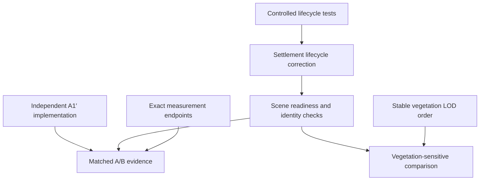

# Deep determinism and benchmark reproducibility audit

**Date:** 2026-10-28  
**Repository / inspected main:** `jm-sky/seedvale-v1` @ `4c5a6c15f189c79434e10c04e02a723a2e908bdd`  
**Benchmark reference:** `721af157d6b3aee7ad071647716cd4b4403e936b`  
**Method:** GitHub Connector reads of pinned source, documentation, existing trace report and selected test sources. No runtime implementation, test execution, browser verification, new trace or benchmark. The GitHub comparison shows seven intervening commits, with no `src/` changes; the inspected runtime therefore also describes the reference captures.  
**Status:** audit and proposed corrective sequence, not an implementation plan or approval. D4/D9 remain in force; D1/D3 are future versioning directions.

## 1. Executive summary

The generator, identity registry, streaming lifecycle and rendered workload provide different guarantees. A fixed seed is not a certificate that the same scene was measured.

1. **P0 / confirmed source defect:** pending non-home settlement builds survive an out-of-range recheck, publish without distance revalidation, and can remain loaded indefinitely while the player stands still. This is a production streaming defect, not a benchmark-only artifact. It is the **strongest hypothesis**, not proven attribution, for the 69/69/53 captures. Neither count is automatically correct.
2. **P1 / confirmed:** the population gate observes only an unchanged aggregate NPC count. It does not establish the intended settlement roster, completion of background fauna, successful chunk residency, grass readiness or unique presentation ownership.
3. **P1 / confirmed:** measured-window boundaries differ between report components. `populationEnd` is sampled after isolation probes; pass submissions and auxiliary diagnostics continue through a 200 ms GPU drain after the main session ends. These fields cannot certify the exact measured window.
4. **P1 / confirmed mechanism, unmeasured magnitude:** region vegetation batches concatenate chunks in insertion order, then LOD draws a prefix per species. Different asynchronous arrival orders can show different plants even with identical chunks, generated placements and instance counts.
5. **P2 / confirmed expensive access pattern; unverified hitch causality:** namespace hydration/cap enforcement reads every cache payload for a seed before filtering. This can include large chunk tiles. Persistent cache affects timing substantially in principle, but there is no evidence of cache-corrupted worldgen or cross-profile cache reuse causing the 16-agent discrepancy.

**A1′ may continue.** None of these findings blocks implementing independently correct actor culling. They block claiming a reliable whole-frame FPS gain from unmatched settlement-heavy scenes. Keep existing C0 forest/warm-stream and water verdicts with their documented limits; do not rerun all scenarios because this report exists.

This extends the [focused population investigation](./2026-10-28--settlement-heavy-population-mismatch.md), rather than repeating its artifact census. In particular, the lifecycle defect can be tested independently of identifying the historical 16 agents. The earlier report's caution about choosing a production fix before that identification should not prevent a controlled proof of the invalid retention behavior. It still prevents declaring either historical roster canonical.

## 2. Determinism guarantees and gaps

### Source evidence convention

Paths and line ranges below refer to the inspected SHA, not a moving implementation. Key pinned entry points:

- [SettlementsManager](https://github.com/jm-sky/seedvale-v1/blob/4c5a6c15f189c79434e10c04e02a723a2e908bdd/src/settlement/SettlementsManager.ts#L1051), [createSettlement](https://github.com/jm-sky/seedvale-v1/blob/4c5a6c15f189c79434e10c04e02a723a2e908bdd/src/settlement/createSettlement.ts#L1277).
- [benchmark runner](https://github.com/jm-sky/seedvale-v1/blob/4c5a6c15f189c79434e10c04e02a723a2e908bdd/src/perf/benchmark.ts#L121), [WorldBundle initialization](https://github.com/jm-sky/seedvale-v1/blob/4c5a6c15f189c79434e10c04e02a723a2e908bdd/src/app/worldBundle.ts#L1357).
- [chunk lifecycle](https://github.com/jm-sky/seedvale-v1/blob/4c5a6c15f189c79434e10c04e02a723a2e908bdd/src/terrain/chunkManager.ts#L2443), [worker pool](https://github.com/jm-sky/seedvale-v1/blob/4c5a6c15f189c79434e10c04e02a723a2e908bdd/src/terrain/chunkWorkerPool.ts#L145).
- [persistent cache access](https://github.com/jm-sky/seedvale-v1/blob/4c5a6c15f189c79434e10c04e02a723a2e908bdd/src/persistence/worldgenCacheDb.ts#L45), [vegetation region rebuild](https://github.com/jm-sky/seedvale-v1/blob/4c5a6c15f189c79434e10c04e02a723a2e908bdd/src/terrain/vegetationRegionBatcher.ts#L201), [instance-prefix LOD](https://github.com/jm-sky/seedvale-v1/blob/4c5a6c15f189c79434e10c04e02a723a2e908bdd/src/render/instancedProps.ts#L192).

| Guarantee | Source-backed behavior | Boundary / gap |
| --- | --- | --- |
| Deterministic generated content | `world/parseSeed.ts:createSeededRandom` is a local Mulberry32 stream. `settlementGenerator.ts:cellSeed` derives a cell seed; home preserves the original seed. Families and appearance use dedicated salts/IDs. Terrain noise tables are rebuilt from seed-specific streams. | Equal seed alone is insufficient: configuration, algorithms, authored overlays and cache namespace versions must agree. This audit did not establish bitwise portability across every JS/browser/GPU implementation. |
| Deterministic identity | `npcIdentity.ts:settlementNpcId` uses `${settlementId}:npc:${memberIndex}` in flattened family order; physical seed derives from member index; `npcAppearance.ts` hashes NPC ID. | Stable within an unchanged generated definition. Reordering/inserting families or residents can retarget indices across worldgen changes. Cache version is not a save worldgen epoch. |
| Deterministic materialization | Settlement definitions are keyed; `entries.has(id)` suppresses concurrent duplicate settlement requests. Chunk tile/mesh paths have stronger record/sequence validation. | Settlement publication, background readiness and presentation-owner checks are asynchronous; equal player position alone does not imply equal loaded roster. Hysteresis intentionally also depends on route/history. |
| Deterministic rendered workload | Fixed camera/configuration and complete matching presentations constrain workload. Existing pass collector measures actual submissions. | Animation, culling, fallback assets, foliage prefix ordering, pending finalization and autonomous activity can differ. Equal agent or triangle totals are insufficient. |

### Order-dependent generation versus order-dependent presentation

`settlementPlanCache.ts:uniqueNameFor` (235–263) explicitly resolves names using a stable predecessor-cell order, not request order. `settlementDefFor` (380–395) resolves the deterministic progression/authored-resident context and memoizes results. `roadNetwork.ts:routeBetween` (around 733–760) uses canonical endpoint orientation and an order-independent pair key. These are positive counterexamples to the hypothesis that whichever worker finishes first arbitrarily changes settlement names or routes.

`chunkHeightmap.ts` (472–485) caches seed-specific noise functions, not one globally consumed world RNG. `chunkVegetation.ts:computeChunkVegetation` creates a stream from seed, chunk hash and salt; patches/ferns/riparian/lily/seaweed have separate salts. `grassPlacement.ts:computeChunkGrass` (367 onward) also resets its stream per chunk. Within one chunk the algorithm consumes a sequential stream: changing candidate acceptance or random consumption can change later placements. That matters to CA1/CA2 implementation and cache/version review, but asynchronous job order does not by itself reorder consumption inside these synchronous functions.

`chunkHeightmap.worker.ts` computes each job synchronously from its message. `chunkWorkerPool.ts:pump` prioritizes tile, mesh, knowledge, then grass, with bounded background occupancy; worker count depends on hardware concurrency. Cancellation rejects queued/inflight logical jobs and discards eventual responses rather than terminating workers. This changes completion timing, not the intended data of an unchanged tile request. No shared mutable generation RNG crossing these worker jobs was found in the traced paths.

The concrete presentation exception is region batching (§5/F4). Runtime agent randomness is a separate, real limit (§7), not evidence that settlement definitions were generated differently.

## 3. Settlement lifecycle audit

### Actual ownership and sequence

`src/app/worldBundle.ts` defines settlement load/unload radii of **300/420** (279–282). `SettlementsManager.ts` owns entry lifecycle, persistent in-session economies/households/NPC states and detailed↔offscreen handoffs. `createSettlement.ts` owns runtime props, agents, livestock, rats, colliders and disposal. Home is intentionally pinned; do not remove it merely because the benchmark teleports far away.

At startup:

1. `worldBundle.ts:activateSettlementDefinitionCacheForWorld` awaits best-effort definition hydration before resolving home (1361–1380).
2. The manager starts home `createSettlement` without awaiting the full build (1072–1098), records its promise, and immediately requests two eager neighbors (1214–1216).
3. App readiness starts the render loop and exposes `__seedvaleReady`; `createApp.ts` only catches `worldBundleBackgroundReady` rejection (868), not awaits it before benchmark auto-start (3874–3909).
4. The benchmark resolves its target from definitions, teleports, then preloads terrain. A subsequent simulation update performs the distance recheck.
5. `recheck` (1306–1321) loads within 300, skips **all pending entries**, and unloads completed non-home entries only beyond 420.
6. `ensureLoaded` (1161–1208) awaits terrain and settlement creation, then checks only whether an entry with the ID exists. It publishes without testing latest player distance. Its comment about leaving range is not implemented by the pending-entry policy.
7. The next normal recheck requires 75 units displacement (1159, 1446–1449). Completion does not schedule it.

### Reproducible counterexample from source

Take a non-home startup neighbor S that is outside 420 at the teleport destination. Resolve its build **before** the teleport recheck: S can be unloaded. Resolve the same build **after** that recheck: the pending entry was skipped, S publishes, and a stationary player leaves it retained. Inputs and final player location agree; only promise resolution order differs.

This is enough to establish F1. It does not identify which historical settlements supplied 16 NPCs. Rep3 could omit required unfinished local builds, while reps1/2 could retain extra startup settlements; both possibilities remain distinguishable only with rosters/statuses. Correctness is the residency policy plus lifecycle state, not 53 or 69.

**Production relevance:** ordinary travel while a slow build is in flight, fast travel/teleports and a subsequent pause can retain off-range buildings, colliders, NPCs, livestock and updates. Delayed unload also delays the normal transport/travel handoff. It is more than visual culling; hidden/distant agents still appear in `entry.settlement.update`. No permanent authoritative identity duplication is required for this defect.

### Publication is not atomic

`createSettlement.ts` adds the prop group at 729, then awaits livestock (985), rats (1038), signposts (1062), resident agents and visitors (1381–1512). `materializeSettlementResident` adds each agent mesh as its own promise resolves (1376), before the factory's `Promise.all` finishes. Until the manager receives the complete settlement, these objects are not represented in `getLoaded().npcs` and do not receive the normal settlement update. Thus visible scene content and the aggregate count can disagree during construction.

Disposal guards at home completion and the manager's missing-entry branch eventually dispose a **successfully returned** stale build; `dispose()` clears entries (1722–1743). This contradicts a blanket claim that every pending build leaks forever after teardown. However, work can still attach to the old scene while awaiting completion, and a failure after partial publication has no factory-wide rollback: the manager catch deletes the entry, while the factory's `finally` blocks close timing marks, not all acquired resources. F6 distinguishes that conditional cleanup defect from an observed leak in these captures.

Do not fix F1 by simply deleting pending entries and retaining current key-only continuations. Re-entry can create a new entry with the same ID; old success/catch/finally callbacks could then publish into, delete, or clear the pending status of the replacement. Use entry identity/generation validation on **every continuation**, plus current residency policy and existing cleanup/handoff ownership.

## 4. NPC identity and materialization audit

`createSettlement.ts:materializeSettlementResident` (1316–1378) performs physical-profile generation, `NpcStateRegistry.getOrCreate`, idempotent wealth/artisan/merchant initialization, corpse maintenance, owner gate, awaited `NpcAgent.create`, then scene attachment. `Promise.all` preserves the flattened input order in the final agent array even though individual meshes attach in completion order. It does not assign NPC IDs by asset-completion order.

`npcState.ts:createNpcStateRegistry` (370–427) reuses the same authoritative object for an existing ID; ordinary settlement unload disposes presentations without clearing the registry. Snapshots serialize known states for persistence/rebuild. This is **not** an eagerly enumerated count of every potential resident in the procedural world. Registry size is also not a valid universal benchmark population target.

`npcPresentationOwner.ts:resolveNpcPresentationOwner` chooses visiting destination, no settlement for outbound/returning journey, explicit residency override, or procedural source. `SettlementsManager.ts:resolveTravellingVisitors` (923–954) uses that same policy and resolves the visitor's original identity/physical seed from the cached home definition, without loading home. This is good identity reuse, not a second visitor identity generator.

Limits:

- Owner/death checks occur **before** awaited asset assembly. There is no second owner/death check at attachment. Visitors are collected once during factory construction. An ownership transition while loading can make that decision stale; transitions after a destination is already built are not reconciled by this factory alone. Treat resulting missing/overlapping presentation as F7, not as proven historical duplication.
- The manager map suppresses duplicate settlement builds, and the shared owner policy suppresses normal home/visitor duplication at construction. Neither is a global live-NPC uniqueness assertion. No duplicate ID evidence exists in the three exports.
- `NpcAgent.ts:create` (1956–2020) catches model/assembly failure and returns a capsule; optional animation failure may retain the model without those clips. A matching ID/count can therefore have a radically different mesh workload. `loadGltf.ts:loadCached` memoizes promises by URL, including rejection, for the JS realm; normal game code does not retry by invalidating them. Record fallback/failure status, do not interpret all completed promises as equivalent assets.
- Appearance is ID-seeded (`npcAppearance.ts`); runtime wandering/work/pause choices still use `Math.random` (`NpcAgent.ts:randRange`, 491; look reaction 3207; idle wandering 7080–7099). Stable identity is not deterministic motion replay.

Normal unload (`SettlementsManager.ts:unload`, 1291–1304) captures livestock/rats, stamps agriculture, transfers transport execution and NPC travel checkpoints, then disposes presentations. Preserve these operations when rejecting or reconciling stale work. Deleting authoritative state to achieve a benchmark count would break the intended boundary.

## 5. Worldgen, chunk and cache audit

### Chunk readiness is stronger than a counter, but narrower than scene readiness

`chunkManager.ts:acquireCanonicalTile/ensureLoaded` (2443–2505) revalidates the exact record after cache and worker awaits, clones canonical data before runtime modifications, and waits for mesh **and content** finalization. `buildAndAttachMesh` (1804 onward) also uses record identity and a mesh request sequence. `attachChunkMesh` checks record identity again before adding water/state (2035–2037). These are existing patterns to reuse for settlements.

`waitForChunks` (2825–2841) resolves when requested work finishes **or fails/cancels**; `ensureLoaded.catch` logs and removes failed records without propagating failure. The caller must verify actual residency and content completion if it needs success, especially if streaming unloaded the requested coordinates meanwhile. Merely awaiting the promise does not prove that all requested chunks still exist.

Terrain `state='ready'` becomes true before all content; content finalization additionally gates required templates and builds vegetation/environment synchronously through the queue. `ensureGrass` (1616–1697) launches a separate lower-priority worker job and attaches grass in its callback. It is not chained into `pendingPromise`/`waitForChunks`. Grass has its own radius/hysteresis and completion status; foliage content and grass must not share an assumed readiness signal. Post-window grass census is useful but cannot prove the same buffers were resident at window start.

Chunk unload/reload changes region membership, triggers region mesh reconstruction and can change submitted geometry/LOD while timing is active. Terrain and grass hysteresis deliberately retain some history. A stationary canonical fixture should establish a prescribed startup/teleport history and reconcile pending work; a streaming scenario should record a route and compare workload along that route, not demand a constant resident set throughout.

### Region insertion order survives into LOD

`vegetationRegionBatcher.ts:rebuild` (201–219) iterates `rec.chunks.values()` without sorting and concatenates each chunk's placements. `setChunkPlacements` inserts contributions as content finalizes. `render/instancedProps.ts:buildInstancedProps` (146–180) preserves input order within species; `applyCount` (195–206) sets `mesh.count` to a prefix length. For a region/species at fractional LOD, reversing two chunk arrivals changes which placements occupy that prefix. `maxFraction(rec)` can make some near regions full-detail, so this is conditional on fractional region LOD, not a claim that every region differs.

Total placements, species counts and even submitted primitive totals can match while spatial coverage differs. This is not worldgen mutation. It can change overdraw/shadow coverage and appearance; no measured contribution to the reported FPS spread is established. A deterministic contribution order at rebuild is the smallest fix candidate. A globally sorted-by-coordinate prefix could retain spatial bias; preserve current per-chunk seeded placement order, and verify appearance before considering any broader stable interleaving scheme. No density reduction is proposed.

### Cache inventory

| Layer / owner | Lifetime; key / fingerprint | Hit/miss semantics and timing | Benchmark treatment |
| --- | --- | --- | --- |
| `settlementPlanCache.ts` maps | JS realm/current world; cell key, policy/naming memos; cleared on world rebuild through road-network cache cleanup | Computed definitions win over late hydration. Cell keys are not independently seed-qualified, so world lifecycle clearing remains essential. | Same world configuration and generation revision; inspect relevant def/ID digest. No global clear per measured frame/run. |
| `settlementWorldgenCache.ts` | IndexedDB/browser profile + origin; `seed/settlement-definitions/v2/cell`, raw terrain params, radius, home-size and resolved progression fingerprint | Validated defs or cached null hydrate the runtime map; generation token prevents stale activation; misses regenerate. Startup awaits best-effort hydrate. Debounced writes/cap cleanup can overlap later work. | Record cold/warm provenance and namespace versions. Fresh profile isolates prior records, not writes created during this launch. |
| `roadNetwork.ts` + `roadRouteWorldgenCache.ts` | Runtime pair map + persistent `road-routes` v1; canonical pair key; terrain/hydrology/home configuration fingerprint | Late hydration does not overwrite computed route; a miss/inflight hydrate runs canonical A*. Algorithm changes need namespace review. | Observe cache state; do not disable roads/cache to make actor numbers stable. |
| `chunkTileWorldgenCache.ts` | Persistent `chunk-tiles` v5; seed, chunk coordinates, hash of full `ChunkTileParams`; 128 MiB per-seed budget and small manifest | Exact-key read; structural validation; miss runs tile worker; canonical arrays/placements are cloned for runtime, preventing digs from contaminating persisted tiles. Hit avoids worker job; write is asynchronous. | Existing hit/miss/invalid/write counters are sufficient initial diagnostics; record deltas and cold/warm label. |
| `chunkManager.ts` / `chunkMeshCache.ts` | Manager-local byte-budgeted LRU mesh data; seed/resolution/size/water/height/region + coordinate + modifications epoch | Reuses data, not live Three.js objects. Cleared at disposal; cutouts applied at attachment. Re-entry can avoid mesh computation. | Record same manager history/route; no reason to disable cache by default. |
| Terrain/noise/river and generated lookup memos | Runtime/worker-local deterministic memoization; seed/config or spatial keys; river tiles reference-counted by chunks | Avoids repeated math; affects scheduling. No demonstrated async RNG corruption. | Same code/config; record pending work where relevant, not every memo entry. |
| `locationsCoarseCache.ts` | Persistent `locations-coarse` v1 plus runtime coarse catalog; seed, tile key, owner-supplied fingerprint | Hydration and dirty flush use generic worldgen cache APIs. Separate from authoritative player discovery/save. | Normally observe provenance; include only if its work overlaps the capture. |
| `assets/loadGltf.ts` and template preloads | JS realm URL→promise/template; browser HTTP cache has its own profile/origin lifetime | Shared immutable GPU/template data and cloned instances; rejection can stay cached; successful fetch timing affects build completion. | Record relevant asset outcome/fallback revision. Fresh profile does not imply cold GPU/driver/OS caches. |
| Save/config persistence | Save IndexedDB and localStorage, separate from disposable worldgen records | `main.ts` and `createApp.ts` fixture bypass save/localStorage overlay and disable autosave for fixture runs. | Existing isolation is valid; do not reopen contamination without evidence. Manual runner invocation in a normal gameplay world does not rebuild that world into the fixture. |

`worldgenFingerprint.ts` canonicalizes object key order and hashes the serialized inputs; array order remains meaningful. Version/fingerprint validation cannot detect a forgotten algorithm-version bump or arbitrary semantically wrong but structurally valid data. The inspected source supplies no demonstrated current cache hit/miss content mismatch. D1/D3 remain the right future cross-version boundary, not an urgent prerequisite for A1′.

Existing test **sources** cover settlement hydration overwrite/stale activation, cache misses/failures and chunk clone isolation/round-trip/invalidation. They were read, not run. The chunk test asserting no namespace-wide API in the tile adapter does **not** cover another namespace loading those tiles through the shared store.

### Cross-namespace read amplification

`worldgenCacheDb.ts:getAllBySeed` (45–53) calls `by_seed.getAll(seed)`. `listCacheRecords` (59–73) and `enforceCacheCap` (183–199) filter namespace/version **after** receiving those records. Settlement, road and coarse-location adapters use these functions; settlement flush invokes cap enforcement even when its own namespace is below the cap.

Therefore a request ostensibly for small definitions/routes can materialize large chunk payloads too. At fixture resolution 193, the eight float grids alone are `8 × 195² × 4 = 1,216,800` bytes per tile, before placements/clone overhead. The chunk namespace's own direct reads and byte-budget manifest do not eliminate this other-caller path. A fresh profile starts empty but can accumulate tiles before a later debounced flush. This is a concrete timing amplification mechanism, not proof it caused a specific 400 ms task.

Prefer a namespace-bounded key-range/index query and metadata/key-only eviction where possible, preserving cache semantics and unrelated records. Do not disable persistence or introduce another cache service as the default fix.

## 6. Benchmark readiness and equivalence audit

### Existing guarantees

`BENCHMARK_FIXTURE` (`benchmarkFixture.ts`) fixes seed 42, day 0, 07:00, terrain resolution 193 and radius 3. `createApp.ts` uses a fixture config without saved overlays; fixture day/night has `enabled:false` (569). The runner forces High. Heavy-settlement selection is deterministic over definitions: size, resident count, squared grid distance, then ID (`heavySettlementScenario.ts:selectHeavySettlement`). It is independent of loaded settlement instances. Forest/water searches use a home-derived anchor, with water checking actual adjacent submerged samples.

These are useful guarantees. They do not wait for all scenario presentations. `scenarioSettlement.residentCount` describes one definition; it is not the expected sum of all loaded agents.

### Signals and what they actually prove

| Signal | Proves | Does not prove |
| --- | --- | --- |
| `settlementDefinitionCacheReady()` | Current best-effort hydrate settled | All definitions/builds/assets or scene are ready |
| `homeReady` | Full home factory returned (or rejects) | Eager/target neighbors reconciled; home pending marker itself is not cleared by the home success branch |
| `backgroundReady` | Deferred fauna/preloads/home-dependent systems completed, subject to stale-world path | Every streamed settlement ready; benchmark currently does not await it |
| `waitForChunks(ring)` | Requested mesh/content promises settled, including failure/cancellation | Successful current residency; grass; no further neighbor/world work |
| Stable `npcCount` for five seconds | Same aggregate observed at 250 ms polls | Same IDs, assets, correct distance set, no pending invisible/partial build, fauna or grass readiness |
| Scene census | Snapshot of resident scene objects/assets at collection time | Actual per-pass work or measured-window-start state |
| Observed pass submissions | Render submissions during collector session | Equal semantic workload or equal collector/monitor time bounds |

The home entry retains a resolved `pendingPromise` rather than null; a future gate must use explicit settled status/home readiness, not blindly require every existing promise field to be null.

### Measurement boundary defect

In `benchmark.ts` (334–375), `monitor.endSession()` precedes a 200 ms wait; the pass collector remains active and auxiliary diagnostics are snapped after that wait. The streaming timer is also cleared only afterward. Thus submissions/agent totals can cover extra frames beyond the main totals and route end. Scene census follows this delay, then sequential isolation probes run, and only **after probes** does the runner read `populationEnd` and final camera/context (367–425).

This does not invalidate the recorded FPS distribution automatically. It prevents treating the attached end population/census/auxiliary totals as synchronized proof of the timed workload. Preserve the historical artifacts; correct boundary capture prospectively. GPU query draining should collect already-issued queries without extending the logical measured session or route.

`isolationProbe.ts` provides frame-based sample validity and restores visibility/settings. It does not reset the living simulation between probes. New objects attached after `hideBuckets` are not part of the original visibility token set. Isolation deltas remain diagnostic estimates unless workload remained equivalent; they are not simultaneous causal decompositions.

### Minimal workload contract

For a stationary comparison, require equal **inputs and intended content**, while allowing the renderer optimization itself to change draws/mesh structure:

- fixture/configuration/seed/generation versions, selected definition, prescribed startup/teleport history, player anchor and explicit camera pose/projection/layers;
- home/pinned policy plus completed eligible settlement IDs, with no stale out-of-range settlement and no missing required build;
- sorted live NPC IDs with owning settlement, relevant residency/journey/corpse exclusions and asset family/fallback outcome; distinguish wild fauna, settlement livestock/rats and detached livestock;
- requested and resident chunk coordinates, mesh/content success, relevant grass readiness and LOD/configuration; include retained hysteresis/pinned chunks explicitly;
- same graphics/device/resolution, debug flags, weather/time policy and cold/warm cache class, with cache work counters recorded separately;
- dynamic workload summaries (activity/visibility/family counts and existing observed pass data), not a claim of identical animation poses every frame.

Use a **versioned lightweight fingerprint** of sorted stable ID/configuration records before measurement and immediately at actual window end. Store the small constituent lists or diff alongside the digest so a mismatch is actionable. Separate semantic-content identity from implementation-sensitive census: A1′ should change submissions; B may merge meshes; C may reduce unused buffer allocation. Do not reject those intended changes because a draw-count hash changed.

Use existing manager entry/build promises and worker/cache diagnostics through narrow read-only snapshots. Reconcile lifecycle first, then await the relevant finite startup set and verify postconditions. Do not await perpetual gameplay work globally. Record settled errors as failures, not readiness. The old stable-count gate can remain a secondary diagnostic. No full-scene traversal or hashing on every timed frame is needed. Existing lifecycle revision counters, if added at their owners, can cheaply detect a start/end-equal transient structural change without recording every movement.

For `stream`, compare prescribed route/start state and actual reached position/timestamps; resident membership may change intentionally. Wall-clock route scheduling does not guarantee the same callback positions under long tasks. Record these limits rather than calling the current warm route a cold-stream benchmark. Repeated in-page runs retain simulation/cache history and camera state; `canonical: id !== 'current'` alone is not fixture certification.

## 7. Simulation variability assessment

| Process | Current behavior / evidence | Classification and benchmark consequence |
| --- | --- | --- |
| NPC decisions, movement, work, social interactions | `gameLoop.ts` continues passing real `dt`; `NpcAgent.ts` has unseeded wander/pause/work-duration choices. Construction completion determines when a settlement starts updating. | Expected living-world activity, with incomplete replay determinism. Different pre-window active ages can alter poses/work/storage visuals despite fixed day/time. Record a bounded activity summary; do not freeze all agents. |
| Travel, merchant journeys, transport | Manager unload/checkpoint paths preserve authoritative state; presentation policy handles origin/destination ownership at construction. | Journeys are expected; stale publication/owner checks are lifecycle risks. Fresh fixture fixed day and no saved journey weigh against these explaining a 16-resident cohort, not against all movement. |
| Fauna | `createFauna.ts` seeds placement (`seed ^ 0xfa11`) and builds initial cohorts synchronously after template preload; ordinary IDs use per-build counters, persistent occupants use habitat/slot identity. `AnimalAgent.ts:1819` seeds initial life state with `Math.random()`. | Initial positions/content are more controlled than subsequent needs/behavior. Do not describe every animal as world-stable across respawns/rebuilds. Record species/origin/slot where stable and counts/fallbacks otherwise. |
| Birth/respawn/recovery/death | Fauna update uses world-day deltas for managed spawning/recovery, real `dt` for behavior/combat; persistent occupants/tombstones are separate from generic fauna. | Fixed elapsed day limits day-driven transitions in fixture runs; movement/combat/despawn can still change live workload. No globally frozen fauna recommendation. |
| Settlement production/storage/doors | `createSettlement.update` updates NPCs, social pairing, rats, livestock, storage pile visuals and doors (1643–1731). | Expected scene changes; loaded set and active duration influence them. Counts alone do not identify the same environmental workload. |
| Day/night/weather/shadows | Fixture disables day progression; climate derives from fixed seed/day. Clouds/water/grass animation and shadow refresh/culling still execute. | Do not attribute current cross-launch variation to advancing benchmark days. Record view/shadow policy; distinguish cadence variance from missing first-shadow-map initialization, which is already fixed. |
| Streaming and async attachments | Scene content can change after app-ready or count-stable; background fauna is independent of the NPC count. | F1/F2, not intentional autonomous population variability. |

The objective is equivalent realistic **starting workload and bounded variation**, not a bit-identical replay. If remaining actor-state variation materially obscures A1′ after lifecycle/gate repairs, the smallest next check is an activity/asset summary on the same roster. A per-entity deterministic initial-life/random stream may later be considered at the existing owner; it is not necessary to reseed global `Math.random`, rewrite all AI, or block A1′ now.

## 8. Trace and hitch relevance

The [existing report](../trace-results/trace-2026-10-28--0614.md) identifies top-level tasks of 400.5 ms at 16,909.7 ms and 408.0 ms at 17,363.7 ms; the longest frame is 442.3 ms. It also records profiling startup overhead. Embedded profiles lack `timeDeltas`; `req.onsuccess` sample count does **not** prove its callback consumed 400 ms, and reported sampled 0 ms is not evidence of zero cost.

Plausible source paths, with no task-level attribution established:

- `worldgenCacheDb.getAllBySeed` may deserialize/return many large records; hydration continuations validate/merge them. The callback body itself is tiny; distinguish IndexedDB transfer/deserialization, promise continuation and generation work before blaming that line.
- A group of settlement assets resolving can trigger synchronous cloning, skeleton/material setup, collider registration and agent construction. Factory steps publish before final manager registration.
- Chunk content finalization and region rebuilds run synchronously; grass mesh construction runs in independent completion callbacks outside the content-start budget. A budget on starts does not prove a maximum task duration.
- Heavy scenario selection resolves definitions/routes synchronously before teleport; cached versus uncached work changes startup timing. Existing census scans are post-window in the harness; they cannot explain an in-window hitch merely because their names occur in a trace. Pass attribution does execute during its enabled interval.

First inspect the **existing raw trace**, if available to the implementation owner, for the exact two task timestamps, callback metadata and measured-window overlap. This report did not read that raw trace, and the Markdown summary cannot supply those links. Do not request a new trace by default. If cache attribution remains necessary, one bounded diagnostic of namespace request, returned record/byte counts and completion duration distinguishes read amplification from settlement/grass finalization; no full FPS suite is needed.

## 9. Prioritized findings with evidence and confidence

Severity follows the mission's categories, not an emergency-release label. “Confirmed” means established by the code path, not newly reproduced in a browser. For **all findings**, implementation of independent A1′/A/B/C changes may continue; blockers below concern interpretation/certification of measurements.

### F1 — P0: pending settlement retention beyond residency policy

- **Confidence:** confirmed mechanism; **strong hypothesis** for 69/69/53, exact cohort unverified.
- **Paths/symbols:** `SettlementsManager.ts:ensureLoaded` 1161–1208, `recheck` 1306–1321, `update` 1446–1449; `worldBundle.ts` 279–282.
- **Trigger:** non-home pending build crosses outside unload radius before recheck and completes afterward; player then moves less than 75 units.
- **Production impact:** incorrect retained runtime scene, updates/colliders and delayed detailed→offscreen handoff. **Benchmark impact:** different stable populations/buildings under equal fixture/anchor.
- **Minimum correction:** validate entry identity, manager lifetime and current residency at completion; schedule reconciliation without requiring new movement; reject/cancel stale builds through owned cleanup. Preserve home, hysteresis and handoffs.
- **Regression risk:** medium—naive deletion creates same-ID stale-continuation races; premature disposal can lose livestock/travel capture.
- **Blocks:** unmatched A/B scene certification, not rendering implementation. **Necessary test:** controlled promises resolved before/after teleport, stationary completion, rapid leave/re-enter and dispose. Historical roster snapshot only needed to attribute the 16 agents, not to prove F1.

### F2 — P1: readiness cannot certify intended workload

- **Confidence:** confirmed.
- **Paths/symbols:** `benchmark.ts:waitForStablePopulation`, `preloadChunks`, `run`; `createApp.ts` 868, 3874–3909; `chunkManager.ts:ensureLoaded`, `waitForChunks`, `ensureGrass`; `createSettlement.ts` 729, 1376.
- **Trigger:** stable aggregate count with pending/failed/extra/cohort-swapped settlement, background fauna, incomplete grass or failed/cancelled chunk; repeated manual run with inherited world/camera.
- **Production impact:** readiness API limitations, not necessarily a gameplay error. **Benchmark impact:** invalid READY inference and uncontrolled first measured workload.
- **Minimum correction:** relevant lifecycle reconciliation + explicit success/readiness snapshots + identity/config fingerprint; reject missing/extra/pending/fallback mismatch. Do not wait on unrelated permanent background work.
- **Regression risk:** low/medium—overbroad gate can deadlock on resolved home promise, perpetual jobs or intentionally absent travelers.
- **Blocks:** reliable affected-scene comparison. **Necessary tests:** unchanged count with exchanged IDs, slow grass/background fauna, chunk failure/cancellation and stale extra settlement. No new timed capture to test the gate itself.

### F3 — P1: inconsistent measurement boundaries and end metadata

- **Confidence:** confirmed.
- **Paths/symbols:** `benchmark.ts:run` 334–425; `isolationProbe.ts:runIsolationProbes/sampleProbe`.
- **Trigger:** every normal run includes the 200 ms gap; any workload/camera/route change during that gap or probes makes endpoint metadata misleading.
- **Production impact:** none outside tooling. **Benchmark impact:** auxiliary totals/frames and population endpoints do not describe the exact main window; probe deltas can include natural drift.
- **Minimum correction:** stop route/collectors and snapshot IDs, camera, population and auxiliary totals at `monitor.endSession`; drain only already-issued GPU queries; label probe metadata separately.
- **Regression risk:** low, but GPU query lifetime must remain correct. **Blocks:** precise cross-metric/window validation, not use of existing FPS as diagnostics.
- **Necessary test:** controlled clock with population change during drain/probes and collector-frame boundary assertions; no new performance suite.

### F4 — P1: asynchronous chunk arrival changes foliage LOD subset

- **Confidence:** confirmed mechanism; FPS/visual magnitude unverified.
- **Paths/symbols:** `vegetationRegionBatcher.ts:setChunkPlacements/rebuild` 201–247; `render/instancedProps.ts:buildInstancedProps/applyCount` 146–206.
- **Trigger:** same region/species contributions arrive in different orders, with effective LOD fraction below one.
- **Production impact:** history-dependent displayed vegetation subset, not changed authoritative placements. **Benchmark impact:** equal content/count fingerprints can still differ in spatial coverage and GPU work.
- **Minimum correction:** deterministic contribution ordering at the existing rebuild boundary; preserve seeded intra-chunk order, counts and gameplay placement keys.
- **Regression risk:** low/medium—changes which plants survive a fractional draw prefix; verify coverage, shadows and removal-by-key. Do not use it to reduce density.
- **Blocks:** no immediate A1′ blocker; qualify vegetation-sensitive exact comparisons. **Necessary test:** reverse chunk insertion order, compare rendered instance-prefix transforms/keys at fractional LOD; bounded visual check after any fix. No FPS claim until measured when relevant.

### F5 — P2: cache read amplification can perturb completion/hitches

- **Confidence:** confirmed access pattern; unverified responsibility for 400 ms tasks or launch population differences.
- **Paths/symbols:** `worldgenCacheDb.ts:getAllBySeed/listCacheRecords/enforceCacheCap`; settlement/road/coarse adapters' hydrate/flush; `chunkTileWorldgenCache.ts` 59–67.
- **Trigger:** nonempty chunk namespace for the same seed when another namespace hydrates or enforces its cap; can arise within a fresh launch.
- **Production impact:** avoidable transfer/deserialization/allocation/GC risk. **Benchmark impact:** timing and long-tail noise; may alter ordering that exposes F1, without changing generated content.
- **Minimum correction:** scope reads/eviction to namespace/version using existing store/key structure; retain normal caching and fail-open regeneration.
- **Regression risk:** medium if introducing an index/database upgrade; lower for a correctly bounded existing-key range. **Blocks:** nothing immediately; investigate only relevant hitch uncertainty.
- **Necessary evidence:** existing trace alignment or one bounded cache read-size/timing diagnostic. Synthetic mixed-namespace test should verify unrelated tile payloads are not read. No new full benchmark.

### F6 — P0: partial settlement publication has no failure rollback

- **Confidence:** confirmed cleanup gap under post-publication rejection; occurrence in these captures unverified.
- **Paths/symbols:** `createSettlement.ts` scene attachment 729, later awaits 985/1038/1062/1381–1512, final dispose 1739–1753; `SettlementsManager.ts:ensureLoaded.catch` 1201–1204.
- **Trigger:** a later construction stage rejects after props/colliders/one or more agents have attached. Common NPC model-load failure is caught into a fallback and does not itself prove this trigger.
- **Production impact:** partially attached resources can become unreachable from manager cleanup; retry can overlap old presentation. **Benchmark impact:** scene/counter mismatch not explained by loaded roster alone.
- **Minimum correction:** factory-owned cleanup on failed/stale construction, including sibling promises completing after rejection; retain authoritative state and shared GLTF resources. Prefer reuse of the existing disposal primitives, not a second world manager.
- **Regression risk:** medium—double disposal/shared asset disposal and losing persistent state must be avoided. **Blocks:** no evidence of current capture occurrence; not an A1′ blocker.
- **Necessary test:** inject rejection after group attachment and one delayed resident completion; assert no residual scene objects/colliders/labels. No new measurement unless a real leak is observed.

### F7 — P2: NPC presentation ownership can change across asset await

- **Confidence:** strong hypothesis for stale/overlapping presentation; no duplication demonstrated.
- **Paths/symbols:** `createSettlement.ts:materializeSettlementResident` 1339–1377 and visitor construction 1489–1512; `npcPresentationOwner.ts`; `SettlementsManager.ts:resolveTravellingVisitors/resolveMerchantJourneyCheckpoints`.
- **Trigger:** journey/residency/death changes after owner selection but before assembly completes, or visitor eligibility changes after destination construction.
- **Production impact:** potentially stale/missing presentation until a later lifecycle transition; stable authoritative ID alone does not prevent two visual owners. **Benchmark impact:** possible equal-count/different-cohort case, not favored for this fresh fixed-day 16-agent difference.
- **Minimum correction:** revalidate owner/aliveness at attachment; test whether an existing lifecycle seam reconciles live journey transitions before adding any mechanism.
- **Regression risk:** medium/high—must preserve detailed travel and destination ownership. **Blocks:** no.
- **Necessary test:** controlled delayed asset promise plus journey phase/residency change and already-loaded destination; assert one appropriate live owner. No benchmark or global simulation freeze.

### F8 — P2: grass continuations validate key rather than request identity

- **Confidence:** source gap confirmed; replacement-state corruption is a strong hypothesis requiring controlled scheduling.
- **Paths/symbols:** `chunkManager.ts:ensureGrass` 1648–1696, `removeGrass`; `chunkWorkerPool.ts:cancelByNamespacedKey/requestGrass`.
- **Trigger:** old request cancellation/rejection or already-resolved continuation overlaps a replacement request/record with the same key. The ordinary pool cancellation path discards old worker responses; it substantially narrows the risk.
- **Production impact:** an old catch can clear a newer `grassPending`; potential redundant work/stale attachment needs a demonstrated interleaving. **Benchmark impact:** grass readiness/counts may not track the newest request correctly.
- **Minimum correction:** record identity plus request generation guard in both success and failure callbacks, following existing tile/mesh patterns.
- **Regression risk:** low/medium around cancellation/re-entry. **Blocks:** no A1′ blocker.
- **Necessary test:** cancel/re-request in the same turn, delayed reject, resolved-before-cancel and unload/reload of the same key. Do not classify every pending grass job as a leak or require another trace.

Unseeded behavior, animated transforms, intended spawn/death events, legitimate streaming hysteresis and cache timing differences **with equivalent completed content** are expected variability, not additional P0 findings. Unknown artifact-level impacts remain unknown rather than being promoted by theoretical possibility.

## 10. Smallest recommended corrective stages

These are reversible handoff recommendations, **not formal plans or authorization to implement**.

| Order | Owner / bounded change | Acceptance before measuring |
| --- | --- | --- |
| 1 | Production settlement lifecycle: F1, with entry/lifetime guards and owned stale cleanup; cover F6 failure rollback in the same lifecycle boundary or a separate small patch | Deferred-promise tests for finish-before/after teleport, stationary stale completion, rapid re-entry, dispose and injected partial failure; authoritative state/handoffs preserved |
| 2 | Benchmark only: F2 success/readiness snapshot and semantic workload manifest; F3 synchronized endpoints | Gate rejects wrong/missing/extra/failed scenes; accepts valid traveler/corpse exclusions and home readiness; exact end snapshot precedes drain/probes |
| 3 | Production vegetation ordering: F4, independently reversible | Reverse-order unit test yields same fractional prefix; retain placement IDs/counts and inspect coverage visually |
| 4 | Targeted follow-up only: F5 if trace/read-size evidence supports hitch relevance; F7/F8 controlled lifecycle tests before widening runtime scope | Each test separates its hypothesis; no blanket cache disable, global RNG replacement or streaming rewrite |
| 5 | Affected comparison only, when an optimization keep/revert decision needs it | Matched settlement-heavy reference/change using the corrected contract and existing runbook repetition/variance requirements; batch useful candidates, reuse unaffected evidence |

Dependency map:

F1 tests and F3 tooling work can proceed independently. Identifying the historical 16 IDs is useful for attribution but not a prerequisite for proving the lifecycle invariant. Cache/hitch investigation is not on the A1′ implementation dependency path. Do not schedule a full baseline suite after each stage.

## 11. Impact on parallel A/B/C optimization and existing evidence

- **A1′:** continue actor bounds/culling implementation and its normal correctness/visual checks. Compare the same actor IDs, asset outcomes, view and representative activity; the intended drop in actual submissions is a result, not an identity mismatch. Do not claim a whole-frame gain by comparing 53-agent output with a 69-agent reference.
- **B:** extra retained settlements directly alter geometry/collider/update load. Confirm settlement IDs and readiness before interpreting merged-mesh/draw-call gains.
- **C:** preserve D9 C0 → CA1 → CA2 → evaluate. Ensure candidate generation changes do not accidentally shift retained RNG outputs; grass completion and vegetation LOD ordering are distinct issues. A buffer reduction can be valid with unchanged semantic visible coverage; do not require matching implementation-sensitive buffer counts after the optimization.
- **Historical settlement-heavy captures:** still valuable diagnostic evidence of actor/settlement cost and mismatch. Reps1/2 match several aggregate/model-family metrics but differ in environment submissions and tail latency. They are not proof of identical IDs/poses or certified A0a/B0, and rep3 must not be pooled with them as an equal-workload FPS baseline.
- **C0 forest/warm-stream and water:** retain the documented READY-with-limits/control verdicts. The new generic readiness caveats do not prove those captures invalid. Stream's route-dependent residency and the post-window snapshot boundary restrict stronger conclusions. Revisit only if the changed workload/system makes reuse inappropriate.
- No runtime, fixture, harness, previous result or formal plan is changed by this audit. No deterministic world replay, new game epoch or fresh full suite is imposed as a prerequisite for independently correct rendering improvements.

## 12. Explicitly unresolved questions and smallest discriminating evidence

| Question | Smallest useful next test/evidence |
| --- | --- |
| Which settlements/IDs account for 16 agents? | One startup roster comparison at teleport and gate release: entry ID/origin/distance/pending/error, completion/unload order, sorted live/resident/visitor/excluded IDs. No timed FPS window required. |
| Extra startup retention or missing local materialization? | Same snapshot must include **pending** entries and last recheck/player position, not only completed `getLoaded()`. |
| Did partial publication leak in these launches? | Existing errors plus injected late-failure cleanup test; do not infer leak from count mismatch alone. |
| Did region arrival order affect these views materially? | Reverse-order fractional-LOD test first; compare resulting visible instance prefixes at the actual anchor only if needed. |
| What caused the two ~400 ms tasks? | Align existing raw trace task/callback metadata with measured-window/lifecycle timing. If still necessary, one bounded cache-volume/finalization diagnostic. A new trace is a last resort for a specific unresolved attribution. |
| Is cached generation semantically different now? | No evidence yet. Use existing round-trip/invalidation tests plus a small cold-vs-hydrated relevant-def/tile digest comparison if a real mismatch appears; do not globally clear production caches. |
| Does owner transition materialize exactly one NPC? | Deferred asset completion around merchant/residency/death transition and already-loaded destination test. |
| Can a stale grass continuation affect a replacement? | Controlled same-key cancellation/re-request promise schedule. |
| Is remaining same-roster FPS variance thermal, animation, environment or rendering? | Use matched workload manifests and existing pass distributions first; record device power/thermal conditions at the next already-needed A1′ comparison. Do not attribute the existing p95 spread without evidence. |

### Required context consulted

[CLAUDE.md](../../../CLAUDE.md), [Strategic Brief](../../research/v1-revival/STRATEGIC-BRIEF.md), [Master Revival Roadmap](../../research/v1-revival/2026-10-27--master-revival-roadmap.md), [three-track roadmap](../../research/v1-revival/2026-10-27--performance-three-track-roadmap.md), [Arc runbook](../2026-10-27--arc-baseline-runbook.md), [native Windows results](../results/2026-10-27--win-arc-native-harness-fixes-and-baseline.md), [population mismatch audit](./2026-10-28--settlement-heavy-population-mismatch.md), [trace report](../trace-results/trace-2026-10-28--0614.md), navigation/state/architecture and archived tools-001/tools-016 plans. Source overrides older plans and comments. Resolved initial warm-up, camera-control, first-shadow-map and native GPU-timer fixes are not reopened.
