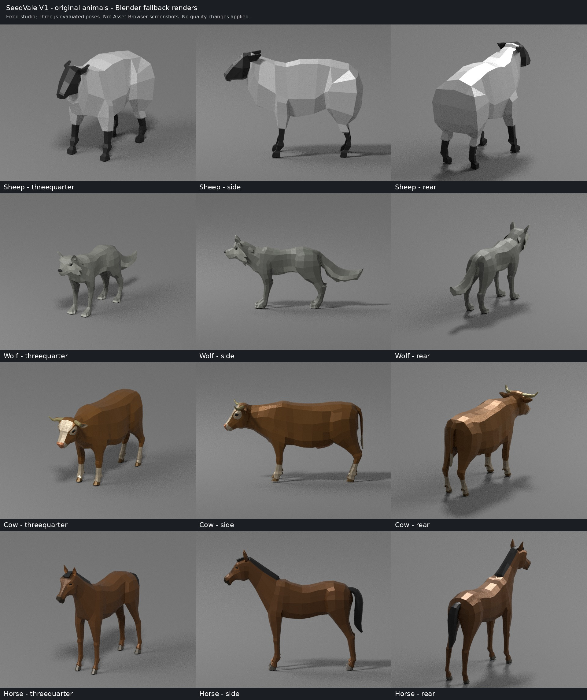
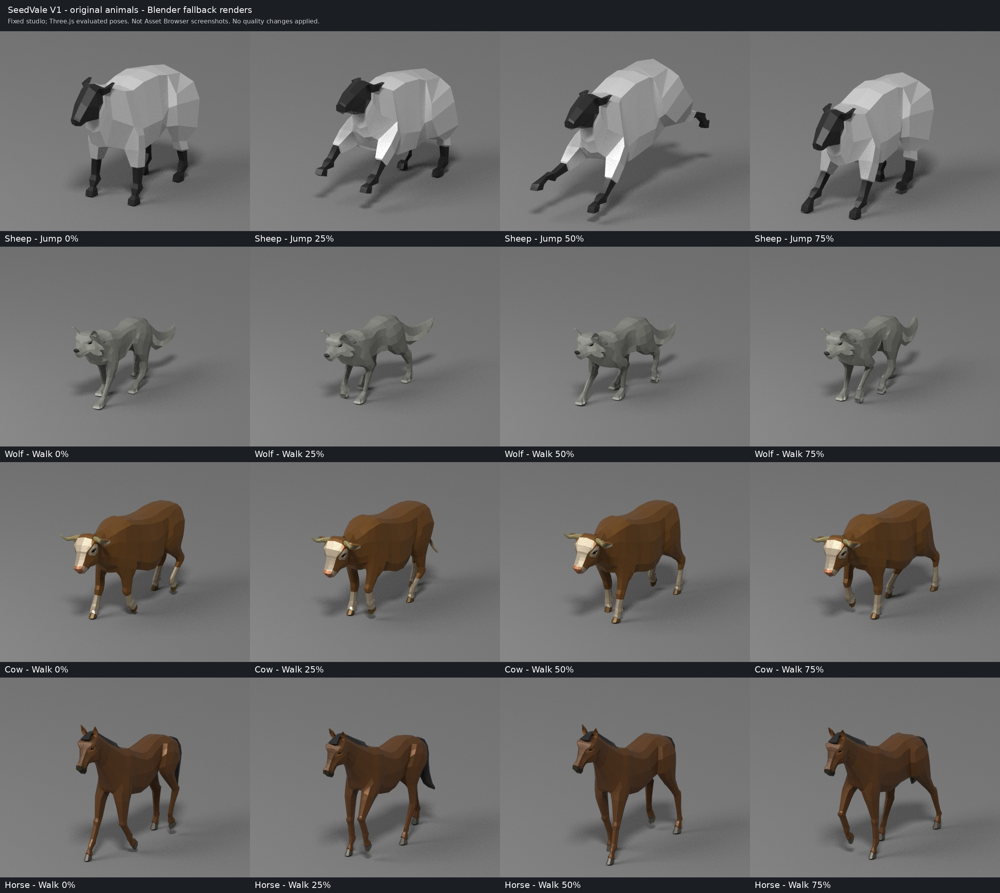

# SeedVale V1 — animal visual quality audit

Research only · 2026-10-30 · `jm-sky/seedvale-v1` at [`cd3363c5b613d1240668add42f3755dea4320656`](https://github.com/jm-sky/seedvale-v1/tree/cd3363c5b613d1240668add42f3755dea4320656).

**Publication note:** this report retains its measured baseline commit above. When publishing on `main` after `9406dcf`, the audited GLBs and rendering paths were unchanged. Repository policy had advanced to P2, with the P1/D4 integration freeze lifted; future experiments should follow the current performance and author-verification policy.

**Recommendation:** begin with corrected dielectric materials and selective smoothing of existing normals, with unchanged geometry, draw calls, rigs and clips. Add restrained baked color variation only after that baseline succeeds. Geometry LOD is unnecessary for the first experiment. A full Blender rig round trip is currently unreliable for two of these files.

## Evidence and limits

**Measured:** original GLB headers, decoded accessors, materials, skins and animations; original-file loading through Three.js **0.185.1** and V1's meshopt decoder; production material-response and skeleton-sharing functions; HTTP responses and SHA-256 hashes. [Machine-readable measurements](2026-10-30--animal-model-visual-quality-audit/measurements.json), [loader inspection](2026-10-30--animal-model-visual-quality-audit/three-runtime-inspection.json), [production lifecycle inspection](2026-10-30--animal-model-visual-quality-audit/runtime-lifecycle.json), [HTTP checks](2026-10-30--animal-model-visual-quality-audit/http-check.json).

`pnpm dev --host 127.0.0.1` started Vite at **http://127.0.0.1:5577/**. `vite.config.ts` reads `PORT` with fallback 5577 and `strictPort: true`; the actual startup address above was used. Asset Browser HTML and all four GLBs returned HTTP 200, and served model hashes match the audited files.

**Rendered and visually inspected:** Blender 4.3.2/Cycles CPU images of static poses evaluated from the original GLBs by Three.js, preserving original triangle indices, per-vertex normals, material colors, metalness and roughness. Three rest-pose angles per animal; midpoint Idle; four Walk phases and midpoint Gallop where available; four Jump phases for sheep. Fixed neutral studio, 640×512, 12 samples, no denoising; animals normalized to 1.5 m height for inspection. Camera framing varies with animal length. Grain in these images is render sampling noise, not an asset texture. [Rendering script](2026-10-30--animal-model-visual-quality-audit/render_audit.py), [pose extraction](2026-10-30--animal-model-visual-quality-audit/sample_three.mjs).

**Not verified:** Asset Browser WebGL output, continuous animation playback, gameplay, GPU/CPU frame timings or target-device performance. Browser-control tools were unavailable. Blender uses a different BRDF implementation, neutral environment illumination and color transform; these are **fallback diagnostic renders, not V1 screenshots**. They establish faceting and missing detail, but cannot quantify V1 gloss, reflections or animation smoothness. No improved model was generated. Production files were left unchanged.

## Technical comparison

Counts include all material primitives of one animal. “Vertices” means exported rendering vertices; coincident positions are not automatically interchangeable skin vertices. Draw counts are **inferred per fully visible beauty pass**, not GPU captures; shadows/AO and viewer layouts can add passes.

| Property | Sheep | Wolf | Cow | Horse |
|---|---:|---:|---:|---:|
| Triangles | **610** | **1,962** | **2,450** | **2,182** |
| Exported vertices | 1,242 | 3,958 | 4,970 | 4,380 |
| Exact distinct positions, across primitives | 307 | 983 | 1,237 | 1,093 |
| GLB meshes / primitives / materials | 1 / 2 / 2 | 1 / 4 / 4 | 1 / 7 / 7 | 1 / 8 / 8 |
| Three.js skinned meshes / inferred beauty draws | 2 / 2 | 4 / 4 | 7 / 7 | 8 / 8 |
| GLB size, KiB | 38.7 | 216.4 | 1,004.5 | 334.9 |
| Decoded binary payload, KiB¹ | 57.3 | 255.1 | 771.3 | 510.2 |
| Metalness / roughness² | 0.400 / 0.415 | **0 / 0.500** | 0.400 / 0.415 | 0.400 / 0.415 |
| Base colors | Gray-white, black | Gray-green body/light coat, dark nose/eyes | Brown/cream hide, muzzle, hooves, horns, eyes | Brown coat shades, dark mane/muzzle, hooves, eyes |
| Material image textures / UV / tangents | None / none / none | None / none / none | None / none / none | None / none / none |
| Material image GPU memory³ | 0 | 0 | 0 | 0 |
| GLB skins / joints / max weighted influences | 1 / 24 / 4 | 1 / 51 / 4 | 1 / 42 / 4 | 1 / 50 / 4 |
| Animation clips | **2** | 12 | 25 | 26 |
| Compression / attribute storage | meshopt + quantization | meshopt + quantization | Uncompressed floats; U16 joints | meshopt + quantization |
| Triangles with identical corner normals | 99.34% | 100% | 100% | 100% |
| Geometry LOD / morph targets | None / none | None / none | None / none | None / none |

¹ Includes geometry, skin matrices and animation data; not a GPU memory measurement. ² Same scalars across every material in each file; confirmed unchanged after V1's natural-material response. Wolf alone is double-sided; the other animals are front-sided. All are opaque, with no normal, roughness, metalness, occlusion, emissive or environment textures. Texture resolution/format are therefore **N/A**, not unknown. ³ Excludes runtime bone palettes, shadow maps and renderer targets.

The compressed files require `KHR_mesh_quantization` and `EXT_meshopt_compression`; position/normal/weight/joint components are U16/I8/U8/U8. Cow is generated by FBX2glTF and retains `fromFBX` metadata identifying Phong-derived, non-authored-PBR materials. The other three identify `gltfpack 1.2`. This metadata supports investigating material conversion, rather than assuming 0.4 metalness was an intentional biological surface choice.

Normals are present and finite, not missing. Quantized normal lengths are approximately 0.994–1.005; cow's float normals are approximately unit length. Normalization alone will not remove the facets. All four have extensive coincident vertices carrying different normals; **no exact coincident-position group has different active joint/weight signatures** in this measurement. That is encouraging for smoothing, but does not prove coincident surfaces should be joined. No degenerate triangles were found.

## Visual findings

The contact sheet archives all twelve original rest-pose angle views. The animation sheet below archives sixteen sampled poses. The full set of 35 individual PNG renders was distributed separately in the audit-session ZIP; the scripts and rendering metadata retained here allow it to be reproduced.

| Animal | Observed in fallback renders | Interpretation / proposed focus |
|---|---|---|
| Sheep | Broad flat patches across back, rump and flank; angular face/legs; uniform white body with no wool surface detail. | Highest benefit expected from wool-specific smoothing plus roughness around 0.9. Preserve ears, hooves and fleece silhouette. |
| Wolf | Body, haunch and tail planes remain obvious; coat markings are large color regions, with no fine fur detail. | Already nonmetallic. Correct normals first, then increase body roughness modestly; preserve muzzle, ears and intentional fur tufts. |
| Cow | Flat shoulder/flank/neck planes and hard color blocks; pronounced highlights on pale facial areas. | Dielectric correction and hide smoothing before any texture work. Give eyes/muzzle their own response. |
| Horse | Flat coat planes and angular neck/haunch shading; mane and tail remain solid low-poly forms without strand detail. | Smooth coat selectively; retain mane/hoof boundaries and a moderate natural coat sheen. |

The GLB metalness of sheep/cow/horse is physically inappropriate for fur/hide and can produce tinted reflective highlights and reduced diffuse response. **Excessive plastic-like gloss in V1 remains a hypothesis**, because V1 was not rendered here. The wolf already has metalness zero, so a uniform “remove metalness” operation cannot solve all four animals.

Sampled poses expose the existing facets while limbs deform. They are a limited pose check, not evidence of continuous motion quality or the absence of problems between samples.

## What V1 actually does

- [`loadGltf.ts`](https://github.com/jm-sky/seedvale-v1/blob/cd3363c5b613d1240668add42f3755dea4320656/src/assets/loadGltf.ts#L48) caches resources by URL, uses meshopt and skinned-safe clones, and shares geometry/materials across ordinary actors. Its natural-material correction is an explicit **rock/wood allow-list**; these four animal materials remain unchanged. `flatShading` is false in Three.js, but authored split normals still produce flat-looking faces.
- `prepareProp` uniformly fits height and centers/grounds the model. Species target heights are sheep **0.68 m**, wolf **0.95 m**, cow **1.30 m**, horse **1.55 m**. Juveniles, alpha variants and dangerous traits apply further uniform scaling. Preserve authored hierarchy, axes and grounding; do not apply mesh/armature transforms casually.
- [`AnimalAgent.ts`](https://github.com/jm-sky/seedvale-v1/blob/cd3363c5b613d1240668add42f3755dea4320656/src/fauna/AnimalAgent.ts#L1827) enables actor-local skeleton sharing by default. Executing the real sharing function on skinned clones reduced skeleton objects **2→1, 4→1, 7→1, 8→1** respectively, with no remapping needed. Preserve this compatibility; adding material parts still adds draws.
- Alpha/dangerous variants clone materials and **replace** their base colors through `tintPropMaterials`; this is not simply a multiplicative darkening of each original region. New color maps/vertex colors would multiply that runtime color and could change variant appearance. Check normal, alpha and quest-dangerous wolves separately.
- [`createRenderer.ts`](https://github.com/jm-sky/seedvale-v1/blob/cd3363c5b613d1240668add42f3755dea4320656/src/render/createRenderer.ts#L32) enables PCF shadows, ACES tone mapping and exposure **0.88**. World light uses ambient, hemisphere and sun illumination varying with time/weather. No animal environment-map assignment was found in the audited path. Sky geometry is not automatically an environment reflection map.
- Asset Browser shares the asset loader and height preparation. Diagnostic alignment lighting is white ambient **0.55** plus directional **0.85** at `(4,8,6)`. Game-like single-view mode uses the production postprocessing chain; quad/diagnostic views do not. Compare like-for-like settings before judging an asset.
- Animals occupy render layer 2 and are excluded from the water-mirror pass. Shadow casting is distance-gated at **36 m**. Animation/presentation updates are full-rate nearby or for important actors; ordinary animals beyond 20 m use nominal 20 Hz, beyond 36 m nominal 10 Hz, shortened by deterministic phase spreading. Thus distant stepping can be runtime cadence, not faulty animation data.
- No fauna geometry LOD, instancing or primitive batching was found in these paths. Native mesh frustum flags remain enabled; the separate `installActorCullBounds` helper is currently called for NPCs, **not AnimalAgent**. Do not assume that helper protects re-exported animal bounds.

## Animation and Blender risks

**Sheep:** only `Armature|Idle` (**6.267 s**) and `Armature|Jump` (**1.133 s**). V1 resolves Idle using its `|name` suffix rule, but has no Walk/Gallop/Attack/Hurt/Death to resolve. Movement therefore retains Idle; death uses the existing fallback. Material/normal work cannot repair that missing locomotion. Preserve these two clips; replacing or adding animations is separate work.

**Wolf:** 12 clips including Idle/Idle_2, Walk (**1.067 s**), Gallop (**0.567 s**), Attack, Death, Eating, hit reactions and jumps. **Cow/horse:** 25/26 clips, including bare names plus `AnimalArmature|...` versions. V1 chooses exact names before suffix matches. They are not safely disposable duplicates: cow's two `Gallop_Jump` versions have different durations (**2.042 vs 1.458 s**); many other paired track payloads differ. Preserve every clip name, duration, target and interpolation. [Complete clip inventory](2026-10-30--animal-model-visual-quality-audit/EVIDENCE.md).

**Measured import obstacle:** after meshopt decoding into temporary audit copies, native Blender 4.3.2 imported wolf/cow, but failed for sheep (`root` bone missing) and horse (`Back` bone missing). The cause was not resolved. This is an importer/workflow obstacle, not proof that the GLBs' runtime skeletons are corrupt: Three.js loads and evaluates them. [Probe result](2026-10-30--animal-model-visual-quality-audit/native-import-probe.json).

Changing normals or PBR scalars does not inherently change skinning. The hazards are incidental re-rigging, bind-matrix/axis/scale changes, lost or renamed actions, vertex welding across different surfaces, changes in skin weights, UV/tangent splits, and smoothing eyes/ears/hooves into surrounding skin. Different normals can also reveal deformation artifacts previously masked by flat shading. Normal maps need a consistent tangent basis and must be checked at UV seams through motion.

## Recommended configurable Blender pipeline

**Preferred architecture:** use Blender for surface processing and baking, then patch only the intended surface attributes/materials into the original glTF document. Keep original nodes, skins, inverse-bind matrices, weights and animation accessors untouched. Given the import failures, a single all-four path can construct **temporary unskinned bind-mesh proxies** from decoded accessors, carrying primitive/vertex IDs and material masks. This avoids depending on native armature import. Proxy-to-original attribute mapping and coordinate conversion must be validated before implementation. The rendered pose snapshots supplied here are diagnostic evidence, not rigged export masters.

1. **Preflight and identity control:** retain source hashes and counts; decode meshopt; pin Blender/export/tool versions. Establish an unchanged-data control and a reversible output directory. Never overwrite originals during the experiment. Reject any accidental rig/action change.
2. **Normals only:** compute selective angle/area-weighted smooth corner normals in bind-mesh space. Suggested trial smoothing threshold **45–60°**, configurable by region. Average across intended connected material boundaries; preserve hard features and separated surfaces. Write normals back to original exported vertex slots. **Do not rely on `shade_smooth` alone:** these GLBs contain split vertices, and Blender's import merge option cannot merge different normals. No subdivision, displacement, remeshing, weight editing or extra geometry.
3. **PBR presets:** set metalness **0** for biological surfaces. Retain recognizable color regions and initially retain material count. Proposed starting ranges, not validated final settings:

   | Preset | Body roughness | Optional detail |
   |---|---:|---|
   | Sheep wool | 0.85–0.95 | Very weak broad wool mottling; later low-amplitude wool normal |
   | Wolf short fur | 0.75–0.90 | Restrained directional coat variation |
   | Cow hide | 0.70–0.85 | Gentle hide color variation; retain face/leg markings |
   | Horse coat | 0.55–0.75 | Subtle coat variation, slightly brighter natural sheen |

   Eyes/muzzles can remain smoother (**roughness roughly 0.25–0.5**); hooves/horns and mane need their own masks. Keep ordinary metallic-roughness materials; avoid clearcoat, sheen extensions or extra lighting features in the first pass.
4. **Variation, only if needed:** deterministic, low-frequency color variation of roughly **±3–5%**, first as vertex colors. Seed and masks must be stable; preserve original patches, eyes and hoof boundaries. Bake procedural Blender noise; arbitrary Blender node graphs do not export as equivalent glTF shaders.
5. **Textures, optional second step:** none of these files has UVs. A 256² base-color atlas per species is a sensible first textured trial; 512² only if closeups justify it. Add padded UV islands, mipmaps and sRGB base color. Keep roughness scalar initially. An optional 256² tangent-space normal map uses linear data and a verified tangent convention; keep strength low and omit it if it shimmers or has no visible gameplay-scale benefit. Avoid runtime noise, triplanar mapping, real-time fur and fur cards.
6. **Export/patch and validate:** preserve IDs/mapping, reapply compatible meshopt/quantization, and compare loaded results through the actual V1 path. Never simplify or resample animations as an incidental export optimization. Treat atlas/material consolidation as a separate measured optimization, since it changes tint behavior and shader/texture workload.

## Expected performance implications

These are **estimates**, not benchmark results.

| Change | Expected cost / constraint |
|---|---|
| Scalars + normals, same vertex slots | No additional draws/triangles/texture fetches or recurring CPU work; same existing smooth-normal shader path. Buffer contents and compressed file size change; no FPS gain claimed. |
| Vertex colors | No extra draw or texture sampler; one vertex attribute and color multiply. About **4 bytes/vertex** if normalized RGBA8, or **16 bytes/vertex** if float RGBA: all four together ~57 KiB or ~227 KiB, before compression. Verify actual exporter storage. |
| One 256² / 512² RGBA8 map + mip chain | Approximately **0.33 / 1.33 MiB per species**, independent of instance count when shared. Across four species: **1.33 / 5.33 MiB**. PNG/WebP file size is not GPU memory. |
| Base-color + normal maps | Approximately **0.67 / 2.67 MiB per species** at 256² / 512²; adds texture sampling and normal reconstruction. UVs add ~8 bytes/vertex if float VEC2; optional tangents ~16 bytes/vertex if float VEC4. Seams may increase vertices despite unchanged triangles. |
| Loading | Added images increase transfer, decoding and upload time; new shader variants can add first-use compilation. Keep maps shared through the existing URL cache. Existing sheep/wolf/horse compression should be retained; cow is a separate compression opportunity. |
| Animation / skinning | Unchanged if original rigs, tracks and vertex counts remain. UV splits add vertex skinning work, not new bones. Current actor sharing should retain one bone palette per animal. |

All four animals together are only **7,204 triangles / 14,550 exported vertices**, but **21 beauty draws** before extra passes. As an illustrative workload, 100 evenly mixed animals would submit about **180,100 triangles and 525 beauty draws** if fully visible. That is an arithmetic scenario, not a scene measurement. Geometry reduction alone would leave those draws and most animation CPU costs intact.

**LOD recommendation:** retain existing geometry for this quality pass. Keep the existing animation cadence and shadow distance. If a target-device herd benchmark later proves fauna cost material, investigate material consolidation/draw submission and animation scheduling before geometric LOD. Any later LOD should reduce a measured bottleneck and preserve silhouettes; no automatic density or simulation reductions are proposed.

## First experiment and acceptance criteria

Use **sheep first**, with wolf as the nonmetallic control. Produce isolated variants: **A** unchanged source/control, **B** material scalars only, **C** B plus selective normals. No new textures, UVs, geometry, material slots or animations. Extend the successful configuration to cow/horse. This tests the likely benefit while exposing the problematic import/mapping path early.

- **Preservation:** exact triangle/primitive/material-slot and exported-vertex counts; same clips, names, durations, joint hierarchy, joint indices, weights, bind matrices and animation channels. With the preferred patch approach, rig/animation payloads should remain byte-identical. Evaluate every clip at ≥24 evenly spaced times; maximum prepared-world positional difference from control **≤0.1 mm**, no detached parts or changed bounds outside that tolerance. The unchanged-data control must pass first.
- **Visual:** inspect the actual Asset Browser at equal camera, size and diagnostic lighting, then single-view game-like daylight, night and torch. Capture front/side/rear and moving closeups at approximately 2 m, 5 m and 15 m. On designated flank/back/haunch regions, ≥90% of intended smooth adjacencies should have a normal discontinuity **<10°**, while marked hard boundaries remain. Author confirms reduced faceting, preserved feature shapes, no wet/plastic coat, seams, shimmer or animation artifacts. This audit does **not** mark that author check passed.
- **Cost:** zero new draw calls, triangles, image textures, per-frame callbacks or skinning vertices. Keep compressed size growth **≤10%** for this texture-free trial, or explain and investigate it. On a fixed-seed (`415424794`) fixed-camera, equal-population A/B, use at least three warmed 60-second runs per arm: provisional acceptance requires median/p95 CPU-render and GPU timings no worse than control by **>3%**, and no worse p99 frame-time trend. If measurement noise exceeds that margin, result is inconclusive. No cloud-render timing substitutes for target hardware.
- **Integration:** prepare evidence for Claude + Blender MCP; follow the current repository performance and author-verification policy before production integration (the D4 freeze recorded at the audit baseline was lifted before this report was published). Keep WSL and native Windows measurements separate. Sheep's missing Walk/Gallop remains an explicit known limitation, not a normal-processing regression.

## Handoff files

[Evidence appendix](2026-10-30--animal-model-visual-quality-audit/EVIDENCE.md) contains hashes, complete materials/clips, scripts and reproduction commands. The companion directory archives contact sheets, machine-readable measurements, import/lifecycle probes, rendering metadata and reproduction scripts. Individual PNG renders and temporary decoded models are not duplicated in the repository. Publication changes research documentation only; production models, code and assets are unchanged.
