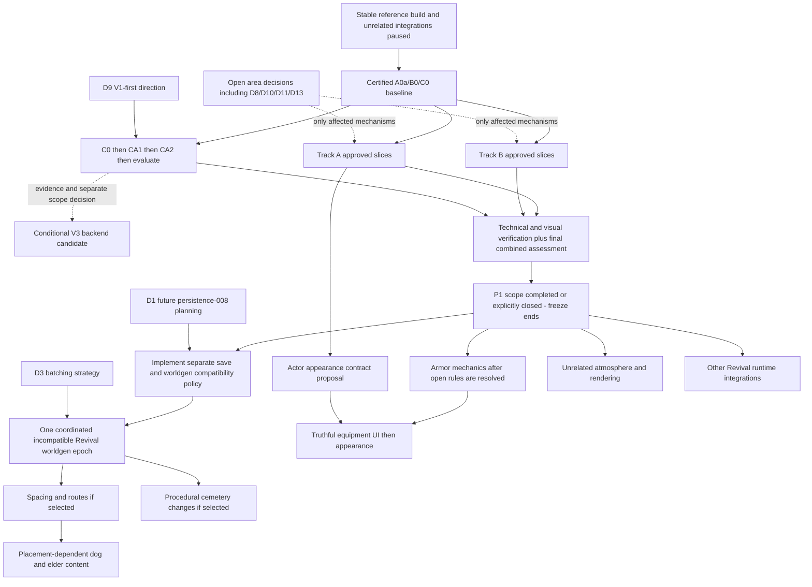

# V1 Revival — Master Roadmap (approved decisions and remaining proposals)

**Created:** 2026-10-27  
**Created by:** Claude Opus 5.5 (coordinator)  
**Status:** **D1/D3/D4/D9 APPROVED (2026-10-27)**; all other decisions and detailed mechanisms remain proposals. D4 supersedes gated parallel lanes with **PERFORMANCE-FIRST**. Performance keep/revert choices remain **PENDING BASELINE**; this is not approval of the entire roadmap.  
**Pins:** V1 `c460b224` · V3 `907e17cd` · V2 = V3 `legacy/SeedVales` (`9ba54815`)  
**Method:** five area audits (static source/doc analysis; **no tests, benchmarks or browser runs** in this session), coordinator cross-review and targeted source spot-checks.

Authority: [Strategic Brief — approved Revival decisions](./STRATEGIC-BRIEF.md#approved-revival-decisions-2026-10-27). Original source pins/method above describe the audit; reconciliation checked save v56 at `c0595d1`. No runtime changes, tests, benchmarks or formal plans were made for reconciliation.

## 0. Inputs (area reports)

| Area | Report | Relation to existing owner |
| --- | --- | --- |
| Equipment, armor & combat | [revival-audit — equipment/armor/combat](./2026-10-27--revival-audit--equipment-armor-combat.md) | Extends [equipment comparison](./2026-10-26--ui-equipment-v1-v3-comparison.md) and catalogue recon/notes |
| NPC / fauna rendering (A) | [revival-audit — NPC/fauna rendering](./2026-10-27--revival-audit--npc-fauna-rendering.md) | Delta + corrections to [transfer recon §10](./2026-10-26--v1-performance-transfer-v2-v3-recon.md#10-track-a-deep-recon--npc-and-fauna-rendering-2026-10-27) |
| Settlement rendering (B) | [revival-audit — settlement rendering (delta)](./2026-10-27--revival-audit--settlement-rendering.md) | Short delta to [§11](./2026-10-26--v1-performance-transfer-v2-v3-recon.md#11-track-b-deep-recon--settlement-rendering-and-static-structures-2026-10-27) |
| Grass / flowers (C) | [revival-audit — grass/flowers V3](./2026-10-27--revival-audit--grass-flowers-v3.md) | Delta + re-recommendation vs [§12](./2026-10-26--v1-performance-transfer-v2-v3-recon.md#12-track-c-deep-recon--v1-grassflower-renderer-adaptation-2026-10-27) |
| Strategy & architecture | [revival-audit — strategy/architecture](./2026-10-27--revival-audit--strategy-architecture.md) | Builds on [Strategic Brief](./STRATEGIC-BRIEF.md), [R7](./2026-10-26--007--unified-candidate-matrix.md), [three-track roadmap](./2026-10-27--performance-three-track-roadmap.md) |

Benchmark evidence used: only diagnostic smoke [032](../../performance/results/2026-10-27--032--benchmark-settlement-heavy.md). **Caveats verified by cross-review:** captured at `e124e866`, *before* the runbook's minimum instrument SHA `94a74470`; one 15 s rep; the 83 ms/frame NPC CPU figure is dominated by a single unattributed 8.49 s frame (≈5.8 ms/frame without it). It is a ranking hint, never a target or a gain claim.

## 1. Cross-review: key verified facts

Spot-checked by the coordinator in current source:

- [code] Incoming combat damage exists only **fauna → player/NPC** (`gameLoop.ts:2982` is the sole `applyIncomingCombatDamage` caller). Armor = fixed per-piece share in `equipment.ts:composeEquipmentModifiers`; no body areas, layers or damage types. Player and NPCs share the rule, but NPCs practically own no armor.
- [code] The transferred V3 catalogue (`src/items/v3Equipment/*`) has **no production consumers** — inert data + adapter.
- [code] `CURRENT_SAVE_VERSION = 56`; saves carry no worldgen version/epoch.
- [code] NPC head/hair/skirt meshes are uncullable (`assembleCharacter.ts:73 frustumCulled = false`); bodies and fauna already use native skinned culling (corrects §10).
- [code] Foliage instanced sway is disabled by a `TEMP` isolation hack (`world/foliageWind.ts`); grass, foliage, water and clouds each own separate wind/time.
- [code] Trade Stage F is implemented (`93cf64ef`, `ui-input-044` = `verification needed`); docs still describing it as "next" are stale.
- [measured-diagnostic, 032] Isolation: hiding NPC+fauna −9.8 ms render (≈507 draws) vs hiding settlements −3.3 ms (≈887 draws); hiding grass ≈0 in that settlement scene. Census over-counts observed main-pass settlement (1520 vs 511) and grass (1.21M vs 0.32M tris) — **use the pass collector, not the census**.

## 2. Resolved contradictions and cross-area conflicts

| # | Conflict | Reconciled direction (remaining mechanisms are proposals) |
| --- | --- | --- |
| X1 | Equipment (E2) and worldgen/spacing both need a save bump; `items-player-044` assumed no bump but `isPlayerEquipmentField` rejects unknown slot keys. | **D1 approved direction:** prepare future `persistence-008`, current proposal v57, with separate save-format/worldgen versioning and understandable pre-Revival refusal; compatible new saves must load correctly. No formal plan or implementation now. Implementation follows P1; later schema changes bump normally, without forcing another worldgen epoch. |
| X2 | Track C porting V3 grass would add a 5th independent wind. | V1-side CA1/CA2 do not depend on shared wind. A future CB prototype must resolve wind ownership without importing unrelated atmosphere implementation into P1; broad wind/water work is deferred. |
| X3 | Mirror pass (≈339 calls) is claimed by water atmosphere, settlements (B1a) and actors (0 actor mirror draws already). | One **reflection policy decision** under existing `world-terrain-015`, still open (D8/D13), informed by B0. A bounded B optimization may proceed only after its required decision; broad water work waits until after P1. Settlement B1a is an implementation of that policy, not a separate one. |
| X4 | Armor visuals multiply actor draws/skeletons (each slot ≥1 draw + skeleton, uncullable on NPC rebind path). | Armor **appearance** waits for the Track A actor visual contract (shared skeleton, merge key, shared bounds). The brief still permits mechanics + UI before appearance, but performance-affecting mechanics integration also waits until after P1. |
| X5 | §10 lists native skinned culling as new / A0a as first Composer task. | Superseded: bodies/fauna already cull natively; A0a tooling shipped (P0). Next A candidate = A1′ inflated sphere incl. head/hair after certified capture and applicable approval. |
| X6 | `grass-finalization.md` ("no pooling by default") vs mandatory Track C. | Track C stays mandatory as a *goal*; mechanism = V1-side memory/upload trims first, pooling (CA6) and V3 backend (CB) only on C0 evidence. |
| X7 | `docs/state/combat.md` claims player→NPC/NPC→NPC damage go through the shared hook. | Doc is wrong vs code; fix in doc-hygiene packet. |
| X8 | Brief §3/§5, readiness review and dossier README describe UI at A–C / Trade "next". | Dated status note in the brief + README correction (done in this commit for README/brief pointer). |

## 3. Dependency graph

D3 batches **incompatible generation**, not every Revival change. D2 mappings are not selected or forced into the epoch. Compatible fixes need no epoch dependency, but must respect D4 workload isolation. Optional CB and other unapproved ideas are not mandatory freeze-exit dependencies. Detailed post-P1 ordering below remains proposed.

## 4. Strategy — Performance-First

**D4 APPROVED, 2026-10-27:** complete A (NPC/fauna rendering), B (settlement rendering/draw submissions), and C (grass/flowers optimization) before integrating unrelated changes that can materially affect performance. This replaces the earlier **gated-parallel-lanes recommendation**. Disjoint files/owners do not establish benchmark isolation; parallel implementation is not the preferred strategy or an objective.

### Integration freeze

Pause unrelated integrations into the **benchmarked V1 branch/codebase** during the A/B/C phase if they may materially change:

- CPU simulation workload; GPU cost; scene complexity or draw calls.
- NPC/fauna counts, model complexity, animation; settlement generation/population.
- Terrain/vegetation density; shaders, lighting, shadows or water reflections.
- World streaming/cache behavior; asset loading, memory allocation or startup.
- Benchmark scenario comparability.

Defer new NPC models/equipment visuals, worldgen/spacing, new weather/wind/cloud/water rendering, broad combat/equipment integration touching active simulation, and other such Revival runtime changes. Existing delivered work is retained; earlier research/plans are **deferred, not cancelled**.

Documentation, research/reconnaissance, architecture analysis, formal planning, unit tests, non-runtime development tooling, inactive data/assets and isolated UI demos may proceed **only when they do not affect bundling, loading, execution or benchmark behavior**. Demos must not start or modify the living world. Separate branches may prepare other work, but performance-affecting changes must wait to merge until exit.

**Entry:** stable reference build plus a certified baseline covering the applicable A/B/C scenarios, with unrelated performance-affecting integrations paused. Pause them already during baseline preparation so the reference stays stable. Current diagnostic/UNVERIFIED captures do not satisfy entry; see [readiness audit](../../performance/audits/2026-10-27--three-track-benchmark-diagnostics-readiness.md) and [Arc runbook](../../performance/2026-10-27--arc-baseline-runbook.md).

**Exit:** the approved A/B/C scope is completed or explicitly closed; accepted changes have appropriate technical and visual verification; the final combined performance result is documented. Record closure/deferment of optional candidates explicitly. An open optional optimization, including V3 CB, must not keep the freeze alive indefinitely. Other Revival implementation then resumes with scope-appropriate verification.

**Necessary exceptions:** critical correctness, security or blocking fixes only. For each, record why it cannot wait, whether benchmark workload changes, the affected commit, and whether a targeted measurement is genuinely required. Do not automatically rerun the full suite. Benchmark comparability, not file ownership or SHA equality alone, controls reuse (§10).

## 5. Phases

Only the Performance-First order and D1/D3/D9 direction are approved. Detailed candidate slices and post-performance phases remain proposals subject to their owning plans/decisions.

| Phase | Content | Entry | Exit / completion evidence |
| --- | --- | --- | --- |
| **P0 — Stable reference and baseline** | Pause unrelated performance-affecting merges; certify A0a/B0/C0 once for applicable scenarios and preserve the reference metadata/reports. Documentation and planning may continue within §4. | Baseline preparation; readiness/runbook quality gates | Stable reference and certified applicable baseline. Otherwise remain explicitly UNVERIFIED/BLOCKED; do not treat that label as a passing gate. |
| **P1 — A/B/C performance implementation** | A: proposed cull bounds A1′/A2′, attribution/cadence and spawn-churn slices; A5′ far detail and A7 merge remain gated by D10/D11 and area choices. B: leading-family submission work; B1a reflection trims require D8/D13, not a broad water rewrite. C: **C0 → CA1 useful filler radius → CA2 generation/storage cap → evaluate**, then CB only if evidence warrants further architecture. | P0 certified baseline; applicable implementation approval and unresolved area decisions for affected slices | Appropriate technical/visual checks, documented keep/revert evidence and **final combined assessment**; approved scope completed or explicitly closed. End freeze; optional candidates do not prolong it. |
| **P2 — Save policy and coordinated worldgen epoch (deferred implementation)** | Future `persistence-008` policy (v57 proposal) before incompatible generator integration; coordinate spacing/routes and procedural cemeteries as applicable in one epoch. Only selected features enter it; D2 mappings stay open. Target only affected worldgen cache namespaces. | **P1 exit**, D1/D3 direction; future plan/scope approval, D2 only if a name change is included | Understandable incompatible-save refusal, compatible-new-save round-trip; one coordinated new-game boundary; coherent routes/transport/IDs and generation checks per future plan |
| **P3 — Atmosphere (deferred proposal)** | Shared wind design, further selected cloud/water work, softer grass/billboard-flower appearance and moon/stars as scoped later. Delivered clouds retained; no new cloud A/B selection gate. Appearance may be planned in P1, but changing shaders/geometry/flowers is not implicitly part of CA1/CA2. | **P1 exit**, applicable scope/design approvals; worldgen only where truly dependent | Author scene review and verification appropriate to the actual change; no inferred reflection/tree-wind approval |
| **P4 — Armor mechanics, equipment UI/content/appearance (deferred proposal)** | Future hit/slot/layer work → truthful UI → balance/acquisition → appearance under actor contract. No simultaneous runtime armor lane. | **P1 exit**; D5/D6 and other applicable rules/content decisions; save policy for persisted changes | Displayed effects = applied effects, player/NPC parity, compatible-save round-trip; guard kits D7 remain open |
| **P5 — Living-world content (deferred proposal)** | Voices stage 1, unowned rescue dog/treasure, elder/sword; later roaming groups retained. Asset loading/runtime integration waits; inert preparation may continue per §4. | **P1 exit**; topology for placement-dependent stories; D12 plan split remains open | Real actors/items/effects, durable state, no duplicated rewards |
| **P6 — Remaining UI/models (deferred proposal)** | Map/menu consultation and selective model replacement, including **NPC & player character visuals** per the [author's character art-direction record](./2026-10-27--npc-character-art-direction.md): named NPC appearance, V1 hand-edited Blender vs V3 kit, body/age variants, hair/beard, skirts/aprons and animation fit. Coordinate dynamic modular armor looks with P4 and the Track A actor visual contract; do not duplicate P4 mechanics here. Isolated UI demos may continue during P1 under §4. Conditional CB remains a candidate, not a mandatory later migration. | **P1 exit** for performance-affecting integration; owning scope/author choices; coordinate P4/Track A interfaces | Verification per owning plan |

**Character-model handoff (author direction, 2026-10-27):** [NPC Character Art Direction](./2026-10-27--npc-character-art-direction.md) is the consolidated record of author decisions, verified static runtime/asset reconnaissance, and open visual-equipment questions. **Claude Opus owns detailed technical reconciliation, phase boundaries, planning and staged handoffs** when this work becomes eligible. The linked research is not an implementation plan and does not pre-approve a full outfit/armor-composition strategy, new performance workload, or post-P1 ordering. D4 Performance-First remains unchanged.

## 6. Shared acceptance rules

- **Performance keep rule (still a proposal):** improvement beyond max(2× rep spread, 5 %) in the relevant decision metric (observed family/pass calls/tris, render p50/p95, frame p95/p99), matched workload/device/configuration with both SHAs recorded, `reliability=observed`, and appropriate author visual review. This threshold and area-specific choices are not approved by D4. Memory/upload-only stages are not reported as FPS gains.
- **Simulation:** no camera-dependent simulation; preserve identity, ownership, offscreen continuity and save/load.
- **Grass:** preserve deterministic V1 world/terrain/simulation, coverage/richness, current fog/visibility, olive palette, intended softer blades and decorative billboard flowers. D9 does not approve density reduction or all appearance mechanisms.
- **Gameplay after P1:** displayed equipment effect = applied effect; player/NPC parity and compatible-new-save round-trips.
- **Verification vocabulary:** Implemented / Technically verified / Browser-manual verified remain distinct (CLAUDE.md). Focused regression tests normally support implementation; performance runs follow §10, not every stage.

## 7. First concrete steps (small, ordered)

These are roadmap handoffs, not actions authorized by this documentation reconciliation.

| # | Step | Owner | Gate |
| --- | --- | --- | --- |
| 1 | Pause unrelated workload-affecting merges; select stable reference; certify shared A0a/B0 and applicable C0, preserve SHA/device/config/workload/raw and human reports | three-track roadmap / Arc runbook | READY/STOP; reuse any already certified comparable evidence |
| 2 | Agree bounded A/B/C implementation scope and remaining area-specific gates using existing audits/plans; do not approve D8/D10/D11/D13 by implication | owning plans / author | certified baseline and applicable decisions |
| 3 | Deliver approved A slices and leading-family B work; for C deliver CA1 then CA2 after C0. Use focused tests/review and independent reversible commits | world-terrain-050 / npc-063 / settlements-019 / grass owner | meaningful keep/revert questions measured per §10; no stage-by-stage full-suite requirement |
| 4 | Evaluate CA1/CA2. Consider V3 tiled backend only if evidence warrants a further architecture decision | Track C | preserve coverage and world identity; no automatic CB commitment |
| 5 | Document final combined A/B/C result and technical/visual verification; close or defer optional scope explicitly and end freeze | performance owners / author review | §4 exit criteria |
| 6 | Resume other Revival runtime implementation under its decisions/plans: save policy before incompatible epoch; armor and atmosphere after P1 | owning plans | no formal `persistence-008` or armor plan created here; open decisions remain open |

Documentation/planning (including future persistence policy preparation), isolated demos and non-runtime tooling may continue meanwhile under §4. They are not a preferred parallel implementation lane.

## 8. Agent allocation

Allocation remains a proposal; additional agents/parallelism are optional.

- **Cursor (Composer):** approved, file-bounded A/B/C slices with existing owners, focused tests and review. No runtime armor E1–E3, voices wiring, worldgen or atmosphere integration during P1 unless a necessary §4 exception applies.
- **GPT Astra:** technical review, baseline certification/comparability review, decision-ledger upkeep; no repeated broad research or automatic benchmarks after every slice.
- **Claude Opus:** cross-system planning/architecture and lifecycle review; persistence/worldgen policy, future armor/wind/appearance contracts may be prepared within §4. Their runtime integrations follow P1. No formal plan creation is part of this reconciliation.

## 9. Decision register

Authority: [dated author record](./STRATEGIC-BRIEF.md#approved-revival-decisions-2026-10-27). “Yes” in the original recommendation column was advice, never approval.

| ID | Decision / direction | Status |
| --- | --- | --- |
| D1 | Separate save format and worldgen compatibility; prepare future persistence-008, v57 current proposal (code v56); clear pre-Revival refusal and correct compatible new-save loading | **APPROVED** — planning/documentation, no immediate implementation |
| D2 | Proposed Anna→Ann, Piotr→Peter, Kasia→Kate, Marek→Mark mappings | **OPEN / UNAPPROVED** |
| D3 | One coordinated incompatible Revival worldgen epoch; not blanket feature approval | **APPROVED** |
| D4 | **PERFORMANCE-FIRST** and controlled integration freeze (§4), replacing gated parallel lanes | **APPROVED** |
| D5 | Per-hit body-area model, weights, protection rules | **OPEN / UNAPPROVED** |
| D6 | Body-only protection rebalance | **OPEN / UNAPPROVED** |
| D7 | Guard armor kits | **OPEN / UNAPPROVED** |
| D8 | Reflection policy: keep / lower cadence / omit detail / sky tint | **OPEN / UNAPPROVED**, informed by baseline |
| D9 | C0 → CA1 → CA2 → evaluate; V3 tiled backend conditional | **APPROVED** |
| D10 | Actor far-detail eye/eyebrow appearance | **OPEN / UNAPPROVED** |
| D11 | Outfit merge/material direction: MeshStandard / Lambert / no merge | **OPEN / UNAPPROVED**, informed by A evidence |
| D12 | Rescue-dog plan 058 split | **OPEN / UNAPPROVED**; prior unowned-dog product decision retained |
| D13 | Small settlement details omitted from reflections | **OPEN / UNAPPROVED** |
| D14 | Tree wind | **OPEN / UNAPPROVED** |

Area-specific secondary decisions (blade implementation, herb variant, flower replacement/density, footprint mask, armor coverage/content and other audit §7 questions) remain open except the explicit D9 preservation/sequence direction. Audit-local D numbers are not this master register.

## 10. Benchmark policy and intake

- Establish **one certified reference baseline set** for the applicable A0a/B0/C0 scenarios. Preserve commit SHA, device/browser, configuration, scene/workload/populations/camera/phase, raw evidence and reports. Reuse it while relevant runtime behavior and workload remain comparable.
- A changed SHA does **not** itself invalidate a baseline. Record both revisions and relevant runtime/workload differences; do not claim gains across incomparable versions or configurations.
- Do not benchmark automatically after every commit or small stage. Prefer focused unit/regression checks. Measure when evidence is needed to decide whether a meaningful optimization should be kept.
- Where practical, assess several independently reversible changes in one measurement session. Keep commits reviewable; if combined results regress, use targeted diagnostics to isolate the cause.
- For necessary exceptions, apply §4's record and decide whether targeted measurement is needed; do not reflexively rerun the full suite.
- Perform and document a **final combined performance assessment before freeze exit**. After exit, new work gets verification appropriate to its own scope.
- This policy controls **when** to measure. Executed runs still satisfy the existing [readiness audit](../../performance/audits/2026-10-27--three-track-benchmark-diagnostics-readiness.md) and [Arc runbook](../../performance/2026-10-27--arc-baseline-runbook.md) quality/READY/STOP requirements; no reduced rep counts, missing metadata or uncertified substitutions.

Paste certified values into the A/B/C audits' **Baseline results slots** (§6), link run artifacts and metadata, then resolve only the affected PENDING BASELINE candidates. Diagnostic 032 and 033–051 remain diagnostic, not certified acceptance. Reorder A/B/C candidates only if evidence warrants; do not reopen strategic D1/D3/D4/D9 decisions.
