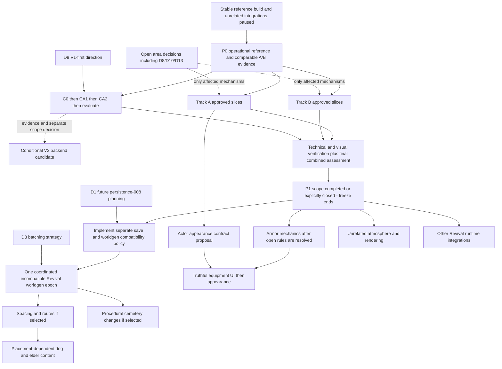

# V1 Revival — Master Roadmap (approved decisions and remaining proposals)

**Gameplay visibility / line of sight (2026-11-05):** [world-042 — character LOS, model concealment and last-known contacts](../../plans/world-042-gameplay-visibility-line-of-sight-and-player-observation.md) implements the author decisions A1–A7 on top of [Astra's review in world-terrain-050](../../plans/world-terrain-050-agent-performance-render-census-and-lod.md#astra-requirements-review--2026-11-05): Stage 0 cave/surface label fix → Stage 1 world sight query + character-eye model concealment + 30 % last-known billboard → Stage 2 light/soft cover in player observation → Stage 3 fauna perception (after fauna-045) → later NPC perception and companion indicator. Gameplay correctness, not a performance slice; world-terrain-050 stays performance-only. Queue Q155–Q158; Stage 1 author questions answered 2026-11-05 (A8–A11).

**Defensive palisade visual upgrade (2026-11-05):** [settlements-025 — modular Blender defensive palisade](../../plans/settlements-025-modular-blender-defensive-palisade.md) defines an asset-first, performance-budgeted replacement for the fence-like V1 palisade visuals. Blender assets/documentation may proceed; runtime integration remains subject to the Strategic Brief D4 gate. Dry-stone field walls are out of scope.

NPC voice storage/identity cleanup (2026-11-05): [final report](2026-11-05--npc-voice-final-cleanup.md), [author decisions](../../assets/voice-qc/author-decisions.json), [casting](../../design/npc-voices/CASTING.md), [catalog](../../design/npc-voices/CATALOG.md). Q88/Q89 casting runtime work remains separate.


**NPC Voices & Dialogue author decisions (2026-10-31):** Six decisions are now approved: fixed per-NPC voice; selective personality variants (initial two-vs-four delegated to Opus); English NPC dialogue with generic quest voice cues and exact displayed details; staged profession/social diversity with more humor; maximum V3 donor voice reuse; moderate event-grounded living-world speech. **Authoritative detailed record:** [Astra NPC voice audit — §12 author decisions](./2026-10-31--npc-voices-dialogue-audit.md#12-author-decisions--approved-2026-10-31-supersedes-open-questions-in-11). These do not approve every recording or assign an immediate implementation slot; schedule through the session queue and normal plan gates.

**Created:** 2026-10-27  
**Created by:** Claude Opus 5.5 (coordinator)  
**Status:** **D1/D3/D4/D9 APPROVED (2026-10-27), D11 APPROVED (2026-10-29)**; all other decisions and detailed mechanisms remain proposals. D4 supersedes gated parallel lanes with **PERFORMANCE-FIRST**. Performance keep/revert choices require scenario-matched evidence; this is not approval of the entire roadmap.  
**Pins:** V1 `c460b224` · V3 `907e17cd` · V2 = V3 `legacy/SeedVales` (`9ba54815`)  
**Method:** five area audits (static source/doc analysis; **no tests, benchmarks or browser runs** in this session), coordinator cross-review and targeted source spot-checks.

Authority: [Strategic Brief — approved Revival decisions](./STRATEGIC-BRIEF.md#approved-revival-decisions-2026-10-27). Original source pins/method above describe the audit; reconciliation checked save v56 at `c0595d1`. No runtime changes, tests, benchmarks or formal plans were made for reconciliation.

**P0 progress update (2026-10-29): OPERATIONALLY COMPLETE — P1 ACTIVE.** Reusable deterministic fixtures, A/B series, native Windows Intel Arc measurements and automated CDP Chrome Trace capture/CPU profiling are available. The author reports a visual check with no issues noticed (2026-10-29; scope/scenes not documented; not a substitute for change-specific verification). The original 2026-10-27 WSL2 A0a/B0/C0 capture remains diagnostic/UNVERIFIED and is **not retrospectively certified**. This is a pragmatic authorization to proceed with P1 using scenario-matched native same-session evidence, **not** a claim that every original formal READY criterion passed. See the [dated baseline evidence update](../../performance/results/2026-10-27--051--a0a-b0-c0-baseline-summary.md#2026-10-29-evidence-update--p0-operational-closure). P1 remains open; keep/revert conclusions are local to each tested slice.

**Author decision (2026-10-29): P1 now includes D — Trees LOD as a fourth required performance area.** The P1 exit review must cover tree LOD with focused V1 recon, a bounded LOD1-first proposal, relevant native Arc/forest measurements, visual checks and a documented implement/close/defer verdict. This is an approved **scope and gate change**, not automatic approval to integrate LOD1, billboard impostors or a V3 tree renderer. Preserve tree density, height, placement, lifecycle, shadows and V1 simulation authority. Existing A/B/C priorities and evidence are retained; no blanket fresh benchmark series is required. [Tree LOD candidate dossier](./2026-10-28--tree-lod-v1-backlog-candidate.md).

## Geography & exploration — approved direction (2026-11-04; P2 epoch 1)

**Decision source:** [Author's G1–G9](./2026-11-04--geography-exploration-author-decisions-g1-g9.md); [architecture proposal](./2026-11-04--geography-exploration-architecture-proposal.md) remains an implementation candidate, not an approved algorithm. Geography joins the **still-open worldgen epoch 1** (G1); this supersedes earlier implied closure after settlement/road changes alone. Keep Q64 road close-out and fixture re-export **after** macro relief, climate-weighted hydrology and settlement recalibration.

**Approved scope:** coherent north/centre/south regions, **possible inland arid/desert areas** (not a decided extent); climate-driven biomes/runoff/local temperature/rain–snow phase; fewer perennial rivers and dry drainage lines without seasonal streams; connected ranges/massifs/passes and some steep summits; initial natural landforms and waterfalls, later volcanic districts/ruins; V2-style vague NPC rumours with an approximate landmark-containing map area (reuse V1 knowledge ownership). **Always keep large structures separate from large settlements (G9)**, rather than allowing co-location after a performance measurement.

**Gates:** S0 previews/profiles/census (including the author's too-long **left road from the home settlement**); inspect V2 waterfall and rumour-area code and V3 peaks/road passes; compare ~22/~25/~28 settlement variants using travel times and previews **for author selection**; decide G8 heights/shape after measurements. Geographic pipeline: relief/landforms → climate → hydrology → biomes/local weather → settlements → roads → fixtures. Keep deterministic generation, save/epoch/cache contracts, visual and performance checks.

### Geography program — staged plans (Opus, 2026-11-04)

**Independent pre-implementation review (2026-11-04):** [Review 031](../../reviews/2026-11-04--031--geography-revival-g1-g9-critical-architecture-review.md) — **REWORK REQUIRED** for the affected execution contracts; S0 diagnostics/recon may proceed. Read its findings before implementing the staged plans below. This is a review recommendation, not a replacement of G1–G9 or an automatic plan rewrite/approval; runtime, visual and performance verification remain outstanding. **Plans amended 2026-11-04 (Opus)** with the F1–F10 corrections (contracts, gates, acceptance) — each contract is still written out in its slice notes before code (061 H2 drainage, 062 W1 local weather, 063 V1 realm/cache, world-041 L0 §0 uncertain knowledge); evidence remains outstanding.

**Cross-plan rules (review 031):**
- **Frozen inputs.** Author previews/shortlists and calibrations name one immutable input revision: climate (061 C2) and hydrology calibration (H1–H2) run on the **060 R4** relief freeze; river-dependent biome output (062 B1–B2), water-dependent catalog entries (world-041 L1) and settlement selection (063 V1) on the **061 H6** freeze. Inert previews and pure contract/lookup work may start earlier.
- **Cache bumps per output-changing slice**, not only at a close-out slice.
- **Later terrain packages** recompute global hydrology and re-run the global invariants plus changed catchment/site/route/catalog-identity checks — no "local re-census only" (F5).
- **Epoch-1 intermediate saves are disposable test saves (F6).** `loadStoredSave` refuses only an epoch mismatch, so a save from an earlier epoch-1 generator loads into a later one without migration of NPCs, terrain edits, trees, buildings, quest locations or checkpoints. Generator-changing slices are QA'd on fresh worlds plus same-build save round-trip/rebuild; rollback pairs a code revision with compatible test saves and regenerated caches. Keeping intermediate saves compatible would need an explicit author decision — no new epoch or migration framework by default.
- **Performance protocol:** tools-026 D7 defines the cost/workload baseline and the meaning of "not slower beyond noise" for 060–063.


Runtime work within these plans is inside approved Revival scope (G1–G9, epoch 1); each plan's author gates (G5 selection, G8 profile, look reviews) still stop the work until answered. Task rows: [queue Q111–Q130](./AUTONOMOUS-SESSION-QUEUE.md#1-queue).

| Stage | Plan | Content | Author gate before the next stage |
| --- | --- | --- | --- |
| **S0** | [tools-026](../../plans/tools-026-geography-baseline-diagnostics.md) | River/relief/route censuses incl. the left-road route, preview layers, preview-only threshold variants, V2/V3 donor recon, baseline packet | baseline + targets confirmed; **G8 height/shape** answer |
| **S1** | Q109 — **done 2026-11-04** | Catalog lakes = real inland water (`locations-coarse` v4; prerequisite of S7 and of any later `locations-coarse` bump) | — |
| **S2** | [world-terrain-060](../../plans/world-terrain-060-macro-relief-ranges-passes-and-landforms.md) | Range spines + passes, summit profile, landform descriptors, P1 landforms (crags, spine summits, lakes with islands, craters) | 7-seed previews (look → §2) |
| **S3–S4** | [world-terrain-061](../../plans/world-terrain-061-macroclimate-and-climate-weighted-hydrology.md) | Static macroclimate → climate-weighted runoff, area thresholds, perennial vs dry drainage, map hierarchy | **regional look on climate previews** (C2) |
| **S5** | [world-terrain-062](../../plans/world-terrain-062-regional-biomes-and-local-precipitation-phase.md) | (T,P) biomes incl. possible inland arid areas, borders (absorbs Q70), local temperature + rain/snow phase | arid extent + browser spots |
| **S5′** | [world-terrain-064](../../plans/world-terrain-064-derived-waterfalls.md) | Derived waterfalls (after V2 donor verdict) | look (§2) |
| **S6** | [world-terrain-063](../../plans/world-terrain-063-geography-driven-settlement-variants.md) | Suitability + 22/25/28 × spacing × weighting matrix → **author picks 1 of 2–3** → implement | **G5 selection** — ✅ 2026-11-07: **B** (25 @ 950 m, `none`) + Q188-a (a) detached islands removed, Q186-a delegated ([decisions](../../plans/implementation-notes/world-terrain-063-geography-driven-settlement-variants-implementation-notes.md#author-decisions-g5--q188-a--q186-a-2026-11-07-and-v4-pre-check-opus)) |
| **S7** | [world-041](../../plans/world-041-landmark-catalog-and-rumour-leads.md) | Landmarks in the catalog, names on discovery, V2-style rumour leads (Astra text) | line script approval |
| **Close-out** | Q44 R5–R8 (Q61–Q64) + Q110 | Road retry on final geography, single fixture re-export, WSL A/B (boot, `stream`, `settlement-heavy`), Windows via §4, **epoch-batch close proposal** | epoch close (G1) |
| later | (no plan yet) | G6 P2: volcanic district, castle/large ruins with per-site budgets, **always separate from large settlements** (G9); Q92 river polish | separate planning |

```text
S0  tools-026 D1–D4, D7 (S) ∥ D5 donors (O) ──► D6 baseline ──► author: G8 profile + targets
S2  060 R0 (after D2, no output change) ──► R1–R2 (after G8) ──► R3 ──► R4 = relief freeze
S3  061 C1 (after R0, previews only) ──► C2 (after R4; author look) ──► H1–H2 (drainage contract first) ──► H3–H5 ──► H6 = hydrology freeze
S5  062 W1 contract (after C1) ──► W1–W2 runtime (after C2) · 062 B1 contract (after C2) ──► B1–B3 acceptance (after H6)
    064 waterfalls: H5 candidates reserved ──► W0 (after D5) ──► W1–W3 (after H6)
S6  063 V0 (after D3) · V1–V3 (after H6 + reserved waterfall footprints, B1 preferred; one pinned router) ──► author G5 ──► V4
    ──► Q61 → Q62 → Q63 (re-run shortlist if journey ranking changes) → Q64 (single fixture re-export) → WSL A/B → Windows §4 → epoch-close proposal
S7  D5 ──► world-041 L0 (incl. uncertain-knowledge contract) ──► L3 (parallel to S3–S6) · L1–L2: dry kinds after 060 R4, water kinds after 061 H6, waterfalls after 064 W1 ──► L4 Astra text ──► L5
```

**Status and next sessions (Opus, 2026-11-06; author priority: 1. geography + hydrology `060 → 062/064 → 063 → roads`, 2. living world):**

| Stage | State |
| --- | --- |
| S0 tools-026 | done |
| S2 060 | **done** — R2 look accepted 2026-11-05, R3/R4 relief freeze accepted 2026-11-06 (residuals → road close-out) |
| S3–S4 061 | C1, C2 look, H1, H3–H6 done 2026-11-06 (technical); H2 dry drainage not built (author Q121-a (a)); open: §3 Q122-a/b, 3D catchment look §2 |
| S5 062 | **B1 contract written (Opus 2026-11-06)** → Q124 (S) ready; B2/B3 after the author's arid look; W1 contract = Q123 (O) |
| S5′ 064 | W0 = Q125 (O) ready; W1 reserved footprints gate 063 V1 |
| S6 063 | V0–V3 done (Q126, Q127, Q186, Q187, Q188) → ✅ author G5 = B (2026-11-07) → **V4 (Q128, S, ready)** → Q61–Q64 |
| S7 world-041 | L0, L3a done; L1 dry + water kinds may start after Q124 lands |
| Settlement composition Q37 | **deferred (author 2026-11-06)** until after biomes, settlement placement and roads; author remarks first |

Session order: **S** Q124 → **O** Q125 W0 + Q123 W1 contract (one session) → **S** 064 W1 → (author arid look) **S** Q164 B2 → Q165 B3 → **S** 064 W2–W3, 062 W1/W2 → **O** Q127 → author G5 → **S** Q128 → Q61–Q64. Living-world lane beside it: **O** Q160 fauna C1 (+ C3 contract) → **S** C2 → C4 → C3 → F3 → F4 → F5.

Parallel lanes: S0 D1–D4, D7 (Sonnet) ∥ D5 (Opus); 060 R0 and 061 C1 change no output and may start early; 063 V0 and world-041 L0/L3 do not wait for the final geography. Worldgen-output slices (060 R1–R4, 061 C2–H6, 062 B1, 063 V4) land **sequentially** so each re-census attributes its change; caches are bumped per namespace in the slice that changes them, the fixture is re-exported once in Q64.

## 0. Inputs (area reports)

| Area | Report | Relation to existing owner |
| --- | --- | --- |
| Equipment, armor & combat | [revival-audit — equipment/armor/combat](./2026-10-27--revival-audit--equipment-armor-combat.md) | Extends [equipment comparison](./2026-10-26--ui-equipment-v1-v3-comparison.md) and catalogue recon/notes |
| NPC / fauna rendering (A) | [revival-audit — NPC/fauna rendering](./2026-10-27--revival-audit--npc-fauna-rendering.md) | Delta + corrections to [transfer recon §10](./2026-10-26--v1-performance-transfer-v2-v3-recon.md#10-track-a-deep-recon--npc-and-fauna-rendering-2026-10-27) |
| Settlement rendering (B) | [revival-audit — settlement rendering (delta)](./2026-10-27--revival-audit--settlement-rendering.md) | Short delta to [§11](./2026-10-26--v1-performance-transfer-v2-v3-recon.md#11-track-b-deep-recon--settlement-rendering-and-static-structures-2026-10-27) |
| Grass / flowers (C) | [revival-audit — grass/flowers V3](./2026-10-27--revival-audit--grass-flowers-v3.md) | Delta + re-recommendation vs [§12](./2026-10-26--v1-performance-transfer-v2-v3-recon.md#12-track-c-deep-recon--v1-grassflower-renderer-adaptation-2026-10-27) |
| Strategy & architecture | [revival-audit — strategy/architecture](./2026-10-27--revival-audit--strategy-architecture.md) | Builds on [Strategic Brief](./STRATEGIC-BRIEF.md), [R7](./2026-10-26--007--unified-candidate-matrix.md), [three-track roadmap](./2026-10-27--performance-three-track-roadmap.md) |

Benchmark evidence used: only diagnostic smoke [032](../../performance/results/2026-10-27--032--benchmark-settlement-heavy.md). **Caveats verified by cross-review:** captured at `e124e866`, *before* the runbook's minimum instrument SHA `94a74470`; one 15 s rep; the 83 ms/frame NPC CPU figure is dominated by a single unattributed 8.49 s frame (≈5.8 ms/frame without it). It is a ranking hint, never a target or a gain claim.

## 1. Cross-review: key verified facts

Spot-checked by the coordinator in current source:

- [code] Incoming combat damage exists only **fauna → player/NPC** (`gameLoop.ts:2982` is the sole `applyIncomingCombatDamage` caller). Armor = fixed per-piece share in `equipment.ts:composeEquipmentModifiers`; no body areas, layers or damage types. Player and NPCs share the rule, but NPCs practically own no armor.
- [code] The transferred V3 catalogue (`src/items/v3Equipment/*`) has **no production consumers** — inert data + adapter.
- [code] `CURRENT_SAVE_VERSION = 56`; saves carry no worldgen version/epoch.
- [code] NPC head/hair/skirt meshes are uncullable (`assembleCharacter.ts:73 frustumCulled = false`); bodies and fauna already use native skinned culling (corrects §10).
- [code] Foliage instanced sway is disabled by a `TEMP` isolation hack (`world/foliageWind.ts`); grass, foliage, water and clouds each own separate wind/time.
- [code] Trade Stage F is implemented (`93cf64ef`, `ui-input-044` = `verification needed`); docs still describing it as "next" are stale.
- [measured-diagnostic, 032] Isolation: hiding NPC+fauna −9.8 ms render (≈507 draws) vs hiding settlements −3.3 ms (≈887 draws); hiding grass ≈0 in that settlement scene. Census over-counts observed main-pass settlement (1520 vs 511) and grass (1.21M vs 0.32M tris) — **use the pass collector, not the census**.

## 2. Resolved contradictions and cross-area conflicts

| # | Conflict | Reconciled direction (remaining mechanisms are proposals) |
| --- | --- | --- |
| X1 | Equipment (E2) and worldgen/spacing both need a save bump; `items-player-044` assumed no bump but `isPlayerEquipmentField` rejects unknown slot keys. | **D1 approved direction:** prepare future `persistence-008`, current proposal v57, with separate save-format/worldgen versioning and understandable pre-Revival refusal; compatible new saves must load correctly. No formal plan or implementation now. Implementation follows P1; later schema changes bump normally, without forcing another worldgen epoch. |
| X2 | Track C porting V3 grass would add a 5th independent wind. | V1-side CA1/CA2 do not depend on shared wind. A future CB prototype must resolve wind ownership without importing unrelated atmosphere implementation into P1; broad wind/water work is deferred. |
| X3 | Mirror pass (≈339 calls) is claimed by water atmosphere, settlements (B1a) and actors (0 actor mirror draws already). | One **reflection policy decision** under existing `world-terrain-015`, still open (D8/D13), informed by B0. A bounded B optimization may proceed only after its required decision; broad water work waits until after P1. Settlement B1a is an implementation of that policy, not a separate one. |
| X4 | Armor visuals multiply actor draws/skeletons (each slot ≥1 draw + skeleton, uncullable on NPC rebind path). | Armor **appearance** waits for the Track A actor visual contract (shared skeleton, merge key, shared bounds). The brief still permits mechanics + UI before appearance, but performance-affecting mechanics integration also waits until after P1. |
| X5 | §10 lists native skinned culling as new / A0a as first Composer task. | Superseded: bodies/fauna already cull natively; A0a tooling shipped (P0). Next A candidate = A1′ inflated sphere incl. head/hair after certified capture and applicable approval. |
| X6 | `grass-finalization.md` ("no pooling by default") vs mandatory Track C. | Track C stays mandatory as a *goal*; mechanism = V1-side memory/upload trims first, pooling (CA6) and V3 backend (CB) only on C0 evidence. |
| X7 | `docs/state/combat.md` claims player→NPC/NPC→NPC damage go through the shared hook. | Doc is wrong vs code; fix in doc-hygiene packet. |
| X8 | Brief §3/§5, readiness review and dossier README describe UI at A–C / Trade "next". | Dated status note in the brief + README correction (done in this commit for README/brief pointer). |

## 3. Dependency graph



D3 batches **incompatible generation**, not every Revival change. D2 mappings are not selected or forced into the epoch. Compatible fixes need no epoch dependency, but must respect D4 workload isolation. Optional CB and other unapproved ideas are not mandatory freeze-exit dependencies. Detailed post-P1 ordering below remains proposed.

## 4. Strategy — Performance-First

**Closed 2026-10-30 (author):** P1 is closed and the integration freeze below is lifted — visual state accepted, no further closure benchmarks, the `settlement-heavy` FPS gap deferred; see [Strategic Brief](./STRATEGIC-BRIEF.md) and the [P1 exit packet](./2026-10-30--p1-exit-packet.md). The text below is kept as the record of the freeze rules.

**D4 APPROVED, 2026-10-27:** complete A (NPC/fauna rendering), B (settlement rendering/draw submissions), and C (grass/flowers optimization) before integrating unrelated changes that can materially affect performance. This replaces the earlier **gated-parallel-lanes recommendation**. Disjoint files/owners do not establish benchmark isolation; parallel implementation is not the preferred strategy or an objective.

### Integration freeze

Pause unrelated integrations into the **benchmarked V1 branch/codebase** during the A/B/C phase if they may materially change:

- CPU simulation workload; GPU cost; scene complexity or draw calls.
- NPC/fauna counts, model complexity, animation; settlement generation/population.
- Terrain/vegetation density; shaders, lighting, shadows or water reflections.
- World streaming/cache behavior; asset loading, memory allocation or startup.
- Benchmark scenario comparability.

Defer new NPC models/equipment visuals, worldgen/spacing, new weather/wind/cloud/water rendering, broad combat/equipment integration touching active simulation, and other such Revival runtime changes. Existing delivered work is retained; earlier research/plans are **deferred, not cancelled**.

Documentation, research/reconnaissance, architecture analysis, formal planning, unit tests, non-runtime development tooling, inactive data/assets and isolated UI demos may proceed **only when they do not affect bundling, loading, execution or benchmark behavior**. Demos must not start or modify the living world. Separate branches may prepare other work, but performance-affecting changes must wait to merge until exit.

**Original entry policy (2026-10-27):** stable reference build plus a certified baseline covering applicable A/B/C scenarios, with unrelated performance-affecting integrations paused. **2026-10-29 operational reconciliation:** P1 already proceeds on native Arc same-session comparisons; old diagnostic/UNVERIFIED captures do not become certified, and each optimization still requires adequate matched evidence. This is a pragmatic P0 closure, not retroactive satisfaction of every old READY item; see [readiness audit](../../performance/audits/2026-10-27--three-track-benchmark-diagnostics-readiness.md) and [Arc runbook](../../performance/2026-10-27--arc-baseline-runbook.md).

**Exit:** the approved A/B/C/D scope is completed or explicitly closed; accepted changes have appropriate technical and visual verification; the final combined performance result is documented. Record closure/deferment of optional candidates explicitly. An open optional optimization, including V3 CB, must not keep the freeze alive indefinitely. Other Revival implementation then resumes with scope-appropriate verification.

**Necessary exceptions:** critical correctness, security or blocking fixes only. For each, record why it cannot wait, whether benchmark workload changes, the affected commit, and whether a targeted measurement is genuinely required. Do not automatically rerun the full suite. Benchmark comparability, not file ownership or SHA equality alone, controls reuse (§10).

## 5. Phases

Only the Performance-First order and D1/D3/D9/D11 direction are approved. Current P1 progress: [tracker snapshot](./2026-10-27--performance-three-track-roadmap.md#p1-status-snapshot-2026-10-29); work order: [Autonomous Session Queue](./AUTONOMOUS-SESSION-QUEUE.md). Detailed candidate slices and post-performance phases remain proposals subject to their owning plans/decisions.

| Phase | Content | Entry | Exit / completion evidence |
| --- | --- | --- | --- |
| **P0 — Stable reference and baseline** | **Operationally complete (2026-10-29)** for ongoing P1: fixtures, native Arc benchmark series, A/B workflow, trace capture and reports exist. Original WSL2 baseline remains diagnostic; consult dated evidence update. | Baseline preparation; readiness/runbook quality gates | Practical P1 measurement workflow established; formal legacy A0a/B0/C0 READY certification **not claimed**. For each P1 decision require matched, reliable evidence and record gaps. |
| **P1 — A/B/C/D(/E) performance implementation — CLOSED 2026-10-30** | A: proposed cull bounds A1′/A2′, attribution/cadence and spawn-churn slices; A5′ far detail remains gated by D10; A7 merge follows approved D11 (first body-only experiment negative). B: leading-family submission work; B1a reflection trims require D8/D13, not a broad water rewrite. C: **C0 → CA1 useful filler radius → CA2 generation/storage cap → evaluate**, then CB only if evidence warrants further architecture. D: **Trees LOD** — bounded recon and decision, LOD1-first with billboard only conditionally; record measured/visual keep-revert or explicit deferment. | P0 operationally complete; use adequate matched native Arc evidence per slice (do not assume old baseline certified); applicable approvals and unresolved decisions for affected slices | Appropriate technical/visual checks, documented keep/revert evidence and **final combined assessment**; approved scope completed or explicitly closed. End freeze; optional candidates do not prolong it. |
| **P2 — Save policy and coordinated worldgen epoch — CURRENT (from 2026-10-30)** | Future `persistence-008` policy (v57 proposal) before incompatible generator integration; coordinate spacing/routes and procedural cemeteries as applicable in one epoch. Only selected features enter it; D2 mappings stay open. Target only affected worldgen cache namespaces. | **P1 exit**, D1/D3 direction; future plan/scope approval, D2 only if a name change is included | Understandable incompatible-save refusal, compatible-new-save round-trip; one coordinated new-game boundary; coherent routes/transport/IDs and generation checks per future plan |
| **P3 — Atmosphere (deferred proposal)** | Shared wind design; **fog sprite anchoring/motion correction** (IMP-001, inspect V1 and V3 first); **streams/rivers**: channel shape and width, bank/bed coloration, riparian vegetation and irregular banks in plan and elevation; cautious, performance-bounded water appearance work (lakes/rivers retain distinct character); softer grass/billboard flowers and moon/stars as scoped. Delivered clouds retained. Changing shaders/geometry/flowers is not implicitly part of CA1/CA2. | **P1 exit** for performance-affecting runtime integration; targeted V1/V3 fog recon and water/terrain ownership and save/worldgen impact checks; applicable design approvals | Author scene review across movement, distances and weather; verify stream/river geometry, bank vegetation, transitions, gameplay depth/physics and representative performance; no inferred reflection/tree-wind approval |
| **P4 — Armor mechanics, equipment UI/content/appearance (deferred proposal)** | Future hit/slot/layer work → truthful UI → balance/acquisition → appearance under actor contract. No simultaneous runtime armor lane. | **P1 exit**; D5/D6 and other applicable rules/content decisions; save policy for persisted changes | Displayed effects = applied effects, player/NPC parity, compatible-save round-trip; guard kits D7 remain open |
| **P5 — Living-world content (deferred proposal)** | Voices stage 1, unowned rescue dog/treasure, elder/sword; later roaming groups retained. Asset loading/runtime integration waits; inert preparation may continue per §4. | **P1 exit**; topology for placement-dependent stories; D12 plan split remains open | Real actors/items/effects, durable state, no duplicated rewards |
| **P6 — Remaining UI/models (deferred proposal)** | Map/menu consultation and selective model replacement, including **NPC & player character visuals** per the [author's character art-direction record](./2026-10-27--npc-character-art-direction.md): named NPC appearance, V1 hand-edited Blender vs V3 kit, body/age variants, hair/beard, skirts/aprons and animation fit. Coordinate dynamic modular armor looks with P4 and the Track A actor visual contract; do not duplicate P4 mechanics here. Isolated UI demos may continue during P1 under §4. Conditional CB remains a candidate, not a mandatory later migration. | **P1 exit** for performance-affecting integration; owning scope/author choices; coordinate P4/Track A interfaces | Verification per owning plan |

### P4 technical design proposal (2026-11-04)

[Combat & Armor Redesign — proposal and Claude Opus handoff](./2026-11-04--combat-armor-redesign-proposal.md) specifies seven slots, two layers, anatomical cut/pierce/blunt protection, shared player/NPC resolution, ordinary armor acquisition, truthful UI, save migrations and stages S0–S8. Read it before formal P4 planning. It reconciles current V1 source with the older audit and identifies corrections needed in items-player-044; it does not overwrite existing plans, approve D5/D6/D7, activate A6 layers, or change A7's inventory-only shields. Author decisions remain with their existing records.

### P6 author scope/status clarification (2026-10-29)

- **P6-B — Minimap & World Map:** author is implementing separately **now**, as an explicit sequencing exception to the Revival roadmap. Track progress through the [map rendering recon](./2026-10-29--minimap-world-map-rendering-recon.md) and its actual implementation owners; do not restart its planning or make this side-work a duplicate P6 implementation dependency. This records the author-reported exception, not independent confirmation of completion.
- **P6-C — Character Models:** **partially delivered (author report)**. The author reports verification of the Blender `.blend` file and Python scripts, export of several models and female skirt work. Further model/outfit work remains; exact coverage and verification must come from the current model plans, notes and code/artifacts, not this high-level report.
- **P6-E — Animation Fit:** some work reportedly completed alongside skirts and the blacksmith apron; completeness is **unverified**. Remaining visual animation-fit evaluation/adjustment requires **author participation** and may be deferred. It must **not block P6 exit** if explicitly tracked as an author-dependent optional follow-up.
- **P6 exit interpretation:** finish or explicitly close selected remaining UI/model scope with owner-plan evidence, avoid redoing finished work, and list author-dependent Blender/animation polish separately. Independent P6 work must not be blocked by the map side-work or optional animation-fit work. Performance-First boundaries remain in force for unrelated runtime merges.

**Character-model handoff (author direction, 2026-10-27):** [NPC Character Art Direction](./2026-10-27--npc-character-art-direction.md) is the consolidated record of author decisions, verified static runtime/asset reconnaissance, and open visual-equipment questions. **Claude Opus owns detailed technical reconciliation, phase boundaries, planning and staged handoffs** when this work becomes eligible. The linked research is not an implementation plan and does not pre-approve a full outfit/armor-composition strategy, new performance workload, or post-P1 ordering. D4 Performance-First remains unchanged.

### P3 author clarification — fog and waterways (2026-10-29)

**Approved product scope / priorities, not a technical implementation plan:**

- **Fog defect:** [IMP-001](../../issues/INBOX.md#imp-001--fog-sprites-follow-player-movement) reports fog sprite/clumps apparently fleeing or drifting with player/camera movement. Compare actual V1 placement/anchoring and updates with V3 first; distinguish intentional camera-relative atmospheric effects from world-space fog and fix the observed defect without automatically transplanting V3's full atmosphere system.
- **Water priority:** water appearance matters, but is **not critical** and must not create a substantial performance regression. Do not imitate V3's reported flat, overly blue water. Prioritize convincing **stream/river channel width and shape**, irregular shoreline in **horizontal and vertical geometry**, bank and riverbed colors, and appropriate distribution of riparian vegetation. Preserve different lake/river appearance and interactions.
- **Cross-phase dependency:** if changes to channel/shore geometry alter deterministic world generation or persisted world topology, coordinate their compatibility/versioning with **P2's selected worldgen epoch** rather than silently introducing another incompatible epoch. This is a dependency check, **not authorization to expand P2's agreed scope**; otherwise keep implementation in P3.
- **Verification:** moving-camera/playback visual review of fog; representative stream/river/lake scenes, banks, crossings and swimming/depth consistency (see [IMP-003](../../issues/INBOX.md#imp-003--swimming-in-visually-shallow-streams)), plus performance checks before retaining expensive water/reflection/shader effects.

This clarifies P3 scope only. It does not override D4 Performance-First or approve a wholesale renderer/worldgen replacement.

### Cave polish — post-P1 candidate (author request, 2026-10-29)

Include a focused **V1 cave polish** work item in later Revival planning, especially **entrance geometry, terrain blending/masking, entrance-to-interior transitions and interior presentation**. Address the reported distant-view defect where cave geometry is culled/not rendered but an exposed bright/white hole remains in the terrain (LOD/visibility continuity). Compare actual V1 and V3 cave implementations before selecting improvements; preserve V1 cave gameplay and world-generation ownership. **Claude Opus owns detailed recon, scope, phase/dependency placement and implementation planning.** This is a roadmap candidate, not an approved implementation plan or exception to the P1 Performance-First freeze.

## 6. Shared acceptance rules

- **Performance keep rule (still a proposal):** improvement beyond max(2× rep spread, 5 %) in the relevant decision metric (observed family/pass calls/tris, render p50/p95, frame p95/p99), matched workload/device/configuration with both SHAs recorded, `reliability=observed`, and appropriate author visual review. This threshold and area-specific choices are not approved by D4. Memory/upload-only stages are not reported as FPS gains.
- **Simulation:** no camera-dependent simulation; preserve identity, ownership, offscreen continuity and save/load.
- **Grass:** preserve deterministic V1 world/terrain/simulation, coverage/richness, current fog/visibility, olive palette, intended softer blades and decorative billboard flowers. D9 does not approve density reduction or all appearance mechanisms.
- **Gameplay after P1:** displayed equipment effect = applied effect; player/NPC parity and compatible-new-save round-trips.
- **Verification vocabulary:** Implemented / Technically verified / Browser-manual verified remain distinct (CLAUDE.md). Focused regression tests normally support implementation; performance runs follow §10, not every stage.

## 7. First concrete steps (small, ordered)

These are roadmap handoffs, not actions authorized by this documentation reconciliation.

| # | Step | Owner | Gate |
| --- | --- | --- | --- |
| 1 | Pause unrelated workload-affecting merges; select stable reference; certify shared A0a/B0 and applicable C0, preserve SHA/device/config/workload/raw and human reports | three-track roadmap / Arc runbook | READY/STOP; reuse any already certified comparable evidence |
| 2 | Agree bounded A/B/C implementation scope and remaining area-specific gates using existing audits/plans; do not approve D8/D10/D13 by implication | owning plans / author | P0 operational evidence plus applicable decisions; capture targeted missing evidence where necessary |
| 3 | Deliver approved A slices and leading-family B work; for C deliver CA1 then CA2 after C0. Use focused tests/review and independent reversible commits | world-terrain-050 / npc-063 / settlements-019 / grass owner | meaningful keep/revert questions measured per §10; no stage-by-stage full-suite requirement |
| 4 | Evaluate CA1/CA2. Consider V3 tiled backend only if evidence warrants a further architecture decision | Track C | preserve coverage and world identity; no automatic CB commitment |
| 5 | Document final combined A/B/C/D result and technical/visual verification; close or defer optional scope explicitly and end freeze | performance owners / author review | §4 exit criteria |
| 6 | Resume other Revival runtime implementation under its decisions/plans: save policy before incompatible epoch; armor and atmosphere after P1 | owning plans | no formal `persistence-008` or armor plan created here; open decisions remain open |

Documentation/planning (including future persistence policy preparation), isolated demos and non-runtime tooling may continue meanwhile under §4. They are not a preferred parallel implementation lane.

## 8. Agent allocation

Allocation remains a proposal; additional agents/parallelism are optional.

- **Autonomous Opus/Sonnet sessions (author, 2026-10-29):** may implement directly on `main` within approved scope and D4; ordering, gates and author-run Arc A/B handoff in the [Autonomous Session Queue](./AUTONOMOUS-SESSION-QUEUE.md).
- **Cursor (Composer):** approved, file-bounded A/B/C slices with existing owners, focused tests and review. No runtime armor E1–E3, voices wiring, worldgen or atmosphere integration during P1 unless a necessary §4 exception applies.
- **GPT Astra:** technical review, baseline certification/comparability review, decision-ledger upkeep; no repeated broad research or automatic benchmarks after every slice.
- **Claude Opus:** cross-system planning/architecture and lifecycle review; persistence/worldgen policy, future armor/wind/appearance contracts may be prepared within §4. Their runtime integrations follow P1. No formal plan creation is part of this reconciliation.

## 9. Decision register

Authority: [dated author record](./STRATEGIC-BRIEF.md#approved-revival-decisions-2026-10-27). “Yes” in the original recommendation column was advice, never approval.

| ID | Decision / direction | Status |
| --- | --- | --- |
| D1 | Separate save format and worldgen compatibility; prepare future persistence-008, v57 current proposal (code v56); clear pre-Revival refusal and correct compatible new-save loading | **APPROVED** — planning/documentation, no immediate implementation |
| D2 | Proposed Anna→Ann, Piotr→Peter, Kasia→Kate, Marek→Mark mappings | **OPEN / UNAPPROVED** |
| D3 | One coordinated incompatible Revival worldgen epoch; not blanket feature approval | **APPROVED** |
| D4 | **PERFORMANCE-FIRST** and controlled integration freeze (§4), replacing gated parallel lanes | **APPROVED** |
| D5 | Per-hit body-area model, weights, protection rules | **OPEN / UNAPPROVED** |
| D6 | Body-only protection rebalance | **OPEN / UNAPPROVED** |
| D7 | Guard armor kits | **OPEN / UNAPPROVED** |
| D8 | Reflection policy: keep / lower cadence / omit detail / sky tint | **OPEN / UNAPPROVED**, informed by baseline |
| D9 | C0 → CA1 → CA2 → evaluate; V3 tiled backend conditional | **APPROVED** |
| D10 | Actor far-detail eye/eyebrow appearance | **OPEN / UNAPPROVED** |
| D11 | Outfit merge/material direction: MeshStandard / Lambert / no merge | **APPROVED (2026-10-29) — V1-first** `MeshStandardMaterial`, selective compatible merges only; first Peasant body-only experiment measured negative and not merged (see brief) |
| D12 | Rescue-dog plan 058 split | **OPEN / UNAPPROVED**; prior unowned-dog product decision retained |
| D13 | Small settlement details omitted from reflections | **OPEN / UNAPPROVED** |
| D14 | Tree wind | **OPEN / UNAPPROVED** |

Area-specific secondary decisions (blade implementation, herb variant, flower replacement/density, footprint mask, armor coverage/content and other audit §7 questions) remain open except the explicit D9 preservation/sequence direction. Audit-local D numbers are not this master register.

## 10. Benchmark policy and intake

- Establish **one certified reference baseline set** for the applicable A0a/B0/C0 scenarios. Preserve commit SHA, device/browser, configuration, scene/workload/populations/camera/phase, raw evidence and reports. Reuse it while relevant runtime behavior and workload remain comparable.
- A changed SHA does **not** itself invalidate a baseline. Record both revisions and relevant runtime/workload differences; do not claim gains across incomparable versions or configurations.
- Do not benchmark automatically after every commit or small stage. Prefer focused unit/regression checks. Measure when evidence is needed to decide whether a meaningful optimization should be kept.
- Where practical, assess several independently reversible changes in one measurement session. Keep commits reviewable; if combined results regress, use targeted diagnostics to isolate the cause.
- For necessary exceptions, apply §4's record and decide whether targeted measurement is needed; do not reflexively rerun the full suite.
- Perform and document a **final combined performance assessment before freeze exit**. After exit, new work gets verification appropriate to its own scope.
- This policy controls **when** to measure. Executed runs still satisfy the existing [readiness audit](../../performance/audits/2026-10-27--three-track-benchmark-diagnostics-readiness.md) and [Arc runbook](../../performance/2026-10-27--arc-baseline-runbook.md) quality/READY/STOP requirements; no reduced rep counts, missing metadata or uncertified substitutions.

Link appropriate comparable native Arc A/B artifacts and metadata in the A/B/C audits' **Baseline results slots** (§6); label diagnostic results accurately and resolve only the affected candidate decisions. Diagnostic 032 and 033–051 remain diagnostic, not certified acceptance. Reorder A/B/C candidates only if evidence warrants; do not reopen strategic D1/D3/D4/D9 decisions.

## Wild fauna architecture review — 2026-11-06

[Review 035](../../reviews/2026-11-06--035--continent-wide-wild-fauna-architecture-review.md): **REWORK REQUIRED** for fauna-050 continental continuity. Recommend holding F3 activation and F4 runtime integration until durable individual authority, save/rebuild equivalence, deterministic catch-up and remote geography ownership are corrected. Pure census/contract work may proceed. **Owner response + author answers Q035-a…d (2026-11-06) are in the plan; C0 landed 2026-11-06 (Q159); next C1 (Opus, Q160) — see the plan's execution sequence.** This records independent review guidance; it does not rewrite the approved plan or queue priorities. Targeted tests: 37 passed; browser and performance evidence outstanding.

## Rendering & performance audit 041 — program (2026-11-06)

[Review 041](../../reviews/2026-11-06--041--rendering-performance-final-critical-synthesis.md) (synthesis of 036–040): 33 canonical findings F16-01…33, **0 Critical / 11 High**, static-only, no measured FPS effect. Integrated into planning by Opus on 2026-11-06 (key mechanisms re-checked at `917f1491`: F16-01, 03, 06, 14, 15, 19, 20, 24, 27, 28 confirmed in current code). Recommendations are **not** approved solutions; the existing Revival priorities (geography main path first, then living world) stay ahead — the S rows form a **parallel lane** (no worldgen output) at the queue position after the geography/fauna rows.

| Lane | Plan | Findings | Queue | Near / later |
| --- | --- | --- | --- | --- |
| Actor correctness | [world-terrain-068](../../plans/world-terrain-068-actor-presentation-correctness-bounds-morphs-retirement.md) | F16-24, 27, 19, 20 (+26 guardrail) | Q173–Q175 | near |
| Streaming correctness | [world-terrain-070](../../plans/world-terrain-070-streaming-worker-occupancy-and-ready-publication.md) C1 | F16-14, 15 | Q176 | near |
| Renderer validity | [world-terrain-069](../../plans/world-terrain-069-renderer-gpu-validity-shadow-coverage-and-recovery.md) | F16-01, 03, 10, 04; F16-02 decision | Q177–Q180 | near (R3b = recon + §3) |
| Simulation scaling | [settlements-npcs-058](../../plans/settlements-npcs-058-simulation-scaling-retained-scan-crowd-and-skip-catch-up.md) | F16-28 fix; F16-29/30/33 measure; F16-32 decision | Q181, Q184 | near (N1, N2); N3 later |
| Attribution (S0) | [tools-027](../../plans/tools-027-frame-attribution-and-benchmark-provenance.md) | F16-06, 09, 31 | Q182, Q183 | near |
| Publication / first use | world-terrain-070 P1–P5 | F16-12, 21, 13, 17 (+16) | Q185 (P1, blocked) | later — measure first |

**Already owned by existing plans (no new plan):** F16-05 mirror relevance → [world-terrain-056](../../plans/world-terrain-056-render-pass-frame-distribution-and-map-quality.md) S2 / Q54 (author §3); F16-07 reflection HDR → D8 (reflection policy, [world-terrain-015](../../plans/world-terrain-015-water-reflection-content-budget.md)) — decision; F16-16 region granularity → [world-terrain-040](../../plans/world-terrain-040-vegetation-render-budget-v2.md) Stage 2 (+ 070 P4); F16-18 far-ring batches → [world-terrain-066](../../plans/world-terrain-066-far-terrain-ring.md) F2 (Q148, deferred); F16-22 hidden-NPC mixers, F16-23 optional-part LOD names, F16-25 multipart draws → [world-terrain-050](../../plans/world-terrain-050-agent-performance-render-census-and-lod.md) (far proxies = D10) + [npc-063](../../plans/npc-063-agent-performance-update-cost-attribution.md); F16-17 prewarm → [plan 149](../../plans/2026-08-17--149--shader-program-first-use-hitch.md) mechanism via 070 P5; F16-21 rollback contract → [settlements-023](../../plans/settlements-023-settlement-streaming-lifecycle-and-construction-rollback.md) Stage B.

**Later backlog (start conditions):** F16-08 point-light variants/overflow — after tools-027 T1 program census shows shader-family growth in a point-light scene; F16-11 fog cards / SMAA order — visual polish, after a matched overdraw/pass-timing capture, author look; F16-23 adapter repair — when world-terrain-050 resumes, needs census + author look (visible change at distance); F16-22/F16-25 — only with npc-063/T2 attribution showing them as the bottleneck; 070 P2–P5 and 058 N3 — rows are created by Q185 / Q184 from measured numbers.

**Decisions needed (queue §3):** Q180-a capability fallback policy (F16-02); Q184-a game-clock semantics under low FPS / tab resume (F16-32); D8 (F16-07 HDR mirror, D8/D13 reflection content), D10 (far actor proxies) stay open and are **not** reopened by 041; WSL benchmark consent for Q185.

**Do-not-break invariants (041 §12):** independent NPC/animal state; stable identities through streaming/save/rebuild; deterministic ecology/stock/travel/quests; acceptance separate from delayed graphics; shared GLTF cache not disposed by actor clones; no unapproved richness reductions; Windows Arc and WSL evidence never mixed.

## Caves and Dungeons — to be planned

Przebudowa jaskiń jest do zaplanowania zgodnie z [docs/roadmap/caves-and-dungeons.md](../../roadmap/caves-and-dungeons.md). Ten dokument opisuje kierunek koncepcyjny, nie zatwierdzony plan implementacji.
