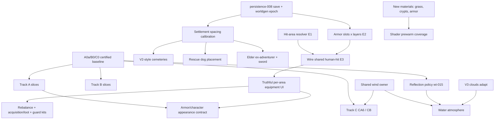

# V1 Revival — Master Roadmap (proposal)

**Created:** 2026-10-27  
**Created by:** Claude Opus 5.5 (coordinator)  
**Status:** **proposal for author approval** — not approved scope, not an execution order until accepted. Performance choices are **PENDING BASELINE** (A0a/B0/C0 running independently).  
**Pins:** V1 `c460b224` · V3 `907e17cd` · V2 = V3 `legacy/SeedVales` (`9ba54815`)  
**Method:** five area audits (static source/doc analysis; **no tests, benchmarks or browser runs** in this session), coordinator cross-review and targeted source spot-checks.

## 0. Inputs (area reports)

| Area | Report | Relation to existing owner |
| --- | --- | --- |
| Equipment, armor & combat | [revival-audit — equipment/armor/combat](./2026-10-27--revival-audit--equipment-armor-combat.md) | Extends [equipment comparison](./2026-10-26--ui-equipment-v1-v3-comparison.md) and catalogue recon/notes |
| NPC / fauna rendering (A) | [revival-audit — NPC/fauna rendering](./2026-10-27--revival-audit--npc-fauna-rendering.md) | Delta + corrections to [transfer recon §10](./2026-10-26--v1-performance-transfer-v2-v3-recon.md#10-track-a-deep-recon--npc-and-fauna-rendering-2026-10-27) |
| Settlement rendering (B) | [revival-audit — settlement rendering (delta)](./2026-10-27--revival-audit--settlement-rendering.md) | Short delta to [§11](./2026-10-26--v1-performance-transfer-v2-v3-recon.md#11-track-b-deep-recon--settlement-rendering-and-static-structures-2026-10-27) |
| Grass / flowers (C) | [revival-audit — grass/flowers V3](./2026-10-27--revival-audit--grass-flowers-v3.md) | Delta + re-recommendation vs [§12](./2026-10-26--v1-performance-transfer-v2-v3-recon.md#12-track-c-deep-recon--v1-grassflower-renderer-adaptation-2026-10-27) |
| Strategy & architecture | [revival-audit — strategy/architecture](./2026-10-27--revival-audit--strategy-architecture.md) | Builds on [Strategic Brief](./STRATEGIC-BRIEF.md), [R7](./2026-10-26--007--unified-candidate-matrix.md), [three-track roadmap](./2026-10-27--performance-three-track-roadmap.md) |

Benchmark evidence used: only diagnostic smoke [032](../../performance/results/2026-10-27--032--benchmark-settlement-heavy.md). **Caveats verified by cross-review:** captured at `e124e866`, *before* the runbook's minimum instrument SHA `94a74470`; one 15 s rep; the 83 ms/frame NPC CPU figure is dominated by a single unattributed 8.49 s frame (≈5.8 ms/frame without it). It is a ranking hint, never a target or a gain claim.

## 1. Cross-review: key verified facts

Spot-checked by the coordinator in current source:

- [code] Incoming combat damage exists only **fauna → player/NPC** (`gameLoop.ts:2982` is the sole `applyIncomingCombatDamage` caller). Armor = fixed per-piece share in `equipment.ts:composeEquipmentModifiers`; no body areas, layers or damage types. Player and NPCs share the rule, but NPCs practically own no armor.
- [code] The transferred V3 catalogue (`src/items/v3Equipment/*`) has **no production consumers** — inert data + adapter.
- [code] `CURRENT_SAVE_VERSION = 56`; saves carry no worldgen version/epoch.
- [code] NPC head/hair/skirt meshes are uncullable (`assembleCharacter.ts:73 frustumCulled = false`); bodies and fauna already use native skinned culling (corrects §10).
- [code] Foliage instanced sway is disabled by a `TEMP` isolation hack (`world/foliageWind.ts`); grass, foliage, water and clouds each own separate wind/time.
- [code] Trade Stage F is implemented (`93cf64ef`, `ui-input-044` = `verification needed`); docs still describing it as "next" are stale.
- [measured-diagnostic, 032] Isolation: hiding NPC+fauna −9.8 ms render (≈507 draws) vs hiding settlements −3.3 ms (≈887 draws); hiding grass ≈0 in that settlement scene. Census over-counts observed main-pass settlement (1520 vs 511) and grass (1.21M vs 0.32M tris) — **use the pass collector, not the census**.

## 2. Resolved contradictions and cross-area conflicts

| # | Conflict | Resolution (proposed) |
| --- | --- | --- |
| X1 | Equipment (E2) and worldgen/spacing both need a save bump; `items-player-044` assumed no bump but `isPlayerEquipmentField` rejects unknown slot keys. | One small **persistence policy plan first** (`persistence-008`, new): v57 adds a worldgen epoch + explicit refusal of pre-revival saves with a clear message; later changes bump normally. Equipment E2 and spacing each take their own subsequent bump. |
| X2 | Track C porting V3 grass would add a 5th independent wind. | **Shared wind owner precedes** any V3 grass backend (CB) and water wind. V1-side grass trims (CA1/CA2) don't depend on it. |
| X3 | Mirror pass (≈339 calls) is claimed by water atmosphere, settlements (B1a) and actors (0 actor mirror draws already). | One **reflection policy decision** under existing `world-terrain-015`, taken together with water work and gated on B0. Settlement B1a is an implementation of that policy, not a separate one. |
| X4 | Armor visuals multiply actor draws/skeletons (each slot ≥1 draw + skeleton, uncullable on NPC rebind path). | Armor **appearance** waits for the Track A actor visual contract (shared skeleton, merge key, shared bounds). Mechanics + UI may ship earlier (brief permits temporary visual mismatch). |
| X5 | §10 lists native skinned culling as new / A0a as first Composer task. | Superseded: bodies/fauna already cull natively; A0a tooling shipped (P0). Next A step = certified capture + A1′ inflated sphere incl. head/hair. |
| X6 | `grass-finalization.md` ("no pooling by default") vs mandatory Track C. | Track C stays mandatory as a *goal*; mechanism = V1-side memory/upload trims first, pooling (CA6) and V3 backend (CB) only on C0 evidence. |
| X7 | `docs/state/combat.md` claims player→NPC/NPC→NPC damage go through the shared hook. | Doc is wrong vs code; fix in doc-hygiene packet. |
| X8 | Brief §3/§5, readiness review and dossier README describe UI at A–C / Trade "next". | Dated status note in the brief + README correction (done in this commit for README/brief pointer). |

## 3. Dependency graph

## 4. Strategy choice

Options considered: performance-first (serial), atmosphere-first, content-first. **Recommended: gated parallel lanes** — performance lanes proceed behind the baseline gate while code-disjoint mechanics (armor rules, persistence policy) and decision work run in parallel; all worldgen-changing work is batched into **one "worldgen epoch"** so the author starts a new game once. Rationale: brief sets no fixed order among performance/atmosphere/UI; the baseline is in flight anyway; armor and persistence code is disjoint from render owners; batching worldgen changes minimises new-game resets and cache bumps.

## 5. Phases

| Phase | Content | Entry | Exit / completion evidence | Priority |
| --- | --- | --- | --- | --- |
| **P0 — Baseline & hygiene** | Certify A0a/B0/C0 (≥3 warm reps, SHA ≥ `94a74470`) and paste into the reports' Baseline slots; cold/warm startup timing; author visual PASS for inventory hybrid, Trade F, settlements-019 Stage 1; doc-hygiene packet (§7 step 2); author decisions D1–D4. | now | Baselines READY or explicitly UNVERIFIED; decisions recorded in brief | P0 |
| **P1 — Performance lanes** | A: A1′ inflated cull sphere (all actor skinned meshes), A5′ far eye/brow hide, A0b mixer/label spans → A3 cadence, A6 no per-spawn GLB clone. B: reflection policy → B1a, then B1b/B2 on leading family. C: C0+ upload probe, CA1 filler radius, CA2 instance cap. | baseline for the lane (A1′ may land with keep/revert decided at baseline) | Per-slice keep rule (§6) + author visual check | P0/P1 |
| **P1∥ — Armor mechanics** | `items-player-062` (new plan): E1 pure hit-area + shared human-hit pipeline (not wired) → E2 slot×layer `EquipmentState` + save bump (re-scoped 044) → E3 wire into player and NPC damage. | persistence-008 for E2 | Unit/regression tests; same hit → same protection for player and NPC; new-game save round-trip | P1 |
| **P2 — Worldgen epoch** | persistence-008 policy → spacing calibration (+10–15 % travel via route evidence) → V2-style cemeteries (graves + size-scaled crypts) → name mapping Ann/Peter/Kate/Mark → targeted worldgen cache bumps. | D1, D2 approved | One new game; routes/merchants/transport coherent; Hidden Finds IDs stable | P1 |
| **P3 — Atmosphere** | Shared wind owner (remove `TEMP` hack properly) → V3 clouds adapt (no A/B) → water (lakes vs rivers) under reflection policy → grass look CA3–CA5 (softer blades, billboard flower clumps, ring fade) → moon/stars (new work). | wind design approved; baseline for perf-sensitive parts | Author scene review (day/night/weather) at current fog distance; prewarm covers new programs | P1/P2 |
| **P4 — Equipment UI & content** | Truthful per-area UI (revise `ui-input-045` for layers) → rebalance + 8 candidate pieces → acquisition via trade/artisans/loot/rewards → deterministic guard kits. Then armor/character appearance under Track A contract. | E3 | Displayed protection = applied protection; acquisition round-trip | P2 |
| **P5 — Living-world content** | Voices stage 1 (independent; can start any time) → unowned rescue dog (split from plan 058) + treasure → elder ex-adventurer + sword → later roaming groups. | P2 for placement-dependent stories | Real actors/items/effects; durable state; no duplicated rewards | P2 |
| **P6 — Remaining UI/models** | Map/menu consultation; selective settlement/character model replacement; optional C CB (V3 grass backend) only if C0 + post-CA evidence warrants. | evidence / author choice | per owning plan | P3 |

## 6. Shared acceptance rules

- **Performance keep rule (proposal):** improvement beyond max(2× rep spread, 5 %) in the lane's decision metric (observed per-pass calls/tris for the family, render p50/p95, frame p95/p99), matched population/SHA/device, `reliability=observed`, no visual regression in author review. Memory-only stages pass on memory/upload with no frame-time regression and are **not** reported as FPS gains.
- **Simulation:** no camera-dependent simulation; identity, ownership, offscreen continuity and save/load untouched by render slices.
- **Gameplay:** displayed equipment effect = applied effect; player/NPC parity tests; new-game round-trip after each save bump.
- **Verification vocabulary:** Implemented / Technically verified / Browser-manual verified kept distinct (CLAUDE.md).

## 7. First concrete steps (small, ordered)

| # | Step | Owner plan | Agent | Gate |
| --- | --- | --- | --- | --- |
| 1 | Certify A0a/B0/C0, paste numbers into the three Baseline slots; separately attribute the 8.49 s frame | three-track roadmap / runbook | author + GPT Astra (review) | runbook READY/STOP |
| 2 | Doc-hygiene packet: revival pointer in `CLAUDE.md`/plans README routing, `pnpm run type-check` (vue-tsc) instead of `npx tsc`, fix `docs/state/combat.md` damage-routing lines, brief UI status note, §10 correction note | — (docs) | Cursor, reviewed by Opus | author OK for CLAUDE.md edit |
| 3 | Author visual PASS: inventory hybrid, Trade F, settlements-019 Stage 1 | ui-input-044 / settlements-019 | author | — |
| 4 | Write `persistence-008` (save v57 + worldgen epoch + pre-revival refusal) | new plan | Claude Opus (plan), Cursor (impl) | D1 |
| 5 | Write `items-player-062`; implement E1 pure hit-area resolver + shared human-hit pipeline with unit tests, unwired | new plan | Opus (plan), Cursor (impl) | D5/D6 |
| 6 | A1′ inflated cull sphere for all actor skinned meshes incl. head/hair (never writes `visible`) | world-terrain-050 | Cursor; Astra review | keep/revert PENDING BASELINE |
| 7 | A0b mixer/label CPU spans | npc-063 | Cursor | none (diagnostic) |
| 8 | CA1 filler generation only inside filler radius, own seeded stream | Track C / grass owner | Cursor | C0 memory metric |
| 9 | Shared wind owner design note (V3 `render/wind/wind.ts` as reference) | new plan if adopted (world-terrain-055) | Claude Opus | author OK |
| 10 | Reflection policy decision → B1a mirror trim for small settlement detail | world-terrain-015 | Opus (decision doc), Cursor (impl) | B0 + author look |

## 8. Agent allocation

- **Cursor (Composer):** single-concern, file-bounded slices with an owner plan and tests — A1′, A5′, A0b, A6, CA1/CA2, B1a/B1b, E1–E3 implementation, doc-hygiene edits, voices stage 1 wiring.
- **GPT Astra:** independent technical review of each Cursor slice; baseline certification review (SHA/variance/STOP); bounded donor comparisons (cemetery layout, cloud adaptation details); decision-ledger upkeep in the brief.
- **Claude Opus:** cross-system plans and contracts — persistence/worldgen epoch, armor rules (`items-player-062`), shared wind owner, actor visual/armor appearance contract, spacing calibration; review of lifecycle-risky changes; AI-agent documentation optimization.

## 9. Decision points for the author

| ID | Decision | Recommendation |
| --- | --- | --- |
| D1 | Save policy: v57 with worldgen epoch, pre-revival saves refused with message | Yes |
| D2 | Name mapping Anna→Ann, Piotr→Peter, Kasia→Kate, Marek→Mark (home families) | Confirm |
| D3 | Batch all worldgen changes into one epoch (one new game) | Yes |
| D4 | Overall strategy: gated parallel lanes (§4) | Yes |
| D5 | Hit model: per-hit sampled body area (area = slot, V3 weights); one protection value per piece; damage types/durability deferred | Yes |
| D6 | Accept lower average protection for body-only kits after body areas (rebalance) | Yes |
| D7 | Guards get deterministic light armor kits in new games | Yes |
| D8 | Reflection policy: keep / lower cadence / drop small detail / V3-style sky tint | PENDING BASELINE; lean "drop small detail" |
| D9 | Track C: V1-side trims first, V3 backend gated (not straight to §12 C1 adapter) | Yes |
| D10 | Actor far-detail: hide eyes/eyebrows beyond shadow range (36 m) | Yes, with visual check |
| D11 | Merge direction for outfits (A7): keep MeshStandard look vs V3 Lambert vs no merge | Decide after A1′–A6 evidence |
| D12 | Split plan 058: household dog stays, new plan for unowned rescue dog | Yes |
| D13 | Small settlement details may be omitted from water reflections if unnoticeable | Yes, with author look |
| D14 | Tree wind excluded by default | Yes |

Area-specific secondary decisions (grass blade look, herb variant, flower density, building-footprint grass mask, armor layer coverage, first armor content) stay in their area reports §7.

## 10. Benchmark intake (how to add results later)

Paste certified numbers only into the **Baseline results slot** tables in the A, B and C reports (§6 of each), add the run file link, then re-evaluate items marked PENDING BASELINE in §5/§7/§9 of this roadmap. No re-analysis is needed unless the baseline contradicts the 032 ranking hint (actors > settlements ≫ grass in settlement-heavy); in that case reorder P1 lanes only.
