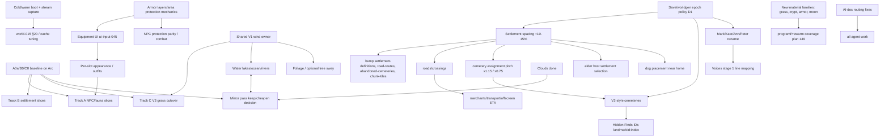

# V1 Revival Audit: Strategy and Architecture (cross-cutting)

**Created:** 2026-10-27 by Claude Opus 5.5 (subagent, one of five parallel specialist auditors)
**Status:** research only, **not approved scope**. Phase order, policies and options below are proposals that need author discussion (see [Strategic Brief §1](./STRATEGIC-BRIEF.md)).
**Pins:** V1 `seedvale-v1` @ `c460b224` (main, clean). V3 donor `seedvale` @ `907e17cd`; V2 donor = `seedvale/legacy/SeedVales` at the same checkout. `seedvale/legacy/seedvale` is a V1-lineage copy, not a donor.
**Sibling audits (dependencies only, not deep-dived here):** equipment/armor/combat, NPC/fauna rendering (Track A), settlement rendering (Track B), grass/flowers (Track C).

**Evidence labels:** **[code]** read in current source at the pin; **[doc]** stated in a repo document and not re-verified; **[measured-diagnostic]** taken from the non-baseline diagnostic smoke `docs/performance/results/2026-10-27--032--benchmark-settlement-heavy.md`; **[hypothesis]** my inference, unverified. No FPS or speed-up claims are made. Decisions that depend on measurement are marked **PENDING BASELINE** (A0a/B0/C0 still running, per the [Arc runbook](../../performance/2026-10-27--arc-baseline-runbook.md)).

Scope stays inside the brief's selected work (§3 of the brief). R1–R7 candidates the brief does not select are left out on purpose, as are the pending terrain-texture and cave suggestions.

---

## 1. Verified state per area

| Area | Exists in V1 (evidence) | Donor available | Status |
| --- | --- | --- | --- |
| **(a) World startup / boot timing** | `src/shared/bootMark.ts` with 28 marks in `src/app/worldBundle.ts` and 7 in `createApp.ts` **[code]**. The only recorded numbers are in `docs/performance/boot-times.md`, dated **2026-08-26**: `createWorldBundle` 6474 ms, `waitForChunks` 1725 ms, `buildSettlementsManager` 1510 ms, `buildFauna` 1026 ms **[doc]**. | V3 nav/tile cache sizing experiment (performance README §H) **[doc]** | **Stale.** The measurement predates `world-015` (2026-09-05). No current cold/warm boot numbers exist. |
| (a) Persistent worldgen caches | `src/persistence/worldgenCacheDb.ts` (`cacheKey(seed, namespace, version, subKey)`, `enforceCacheCap`, `deleteCacheForSeed`). Namespaces: `settlement-definitions` v2 (+ `settlementDefinitionFingerprint`), `road-routes` v1, `chunk-tiles` v5, `abandoned-cemeteries` v2, `locations-coarse` v1, `caves-v2` **[code]**. `world-015` is "in progress": §14 second landmark namespace deferred, §20 measurements not performed **[doc]**. | none needed | Mechanism present; benefit not measured. |
| (a) Cold-world / streaming hitches | Issue 027: settlement build freeze. The `waitForChunks` half was fixed; the `buildInstancedProps()` synchronous half is still open, "secondary, unmeasured" **[doc]**. Diagnostic 032: 12 frames over 80 ms in a 15 s run, max frame 8.5 s, `update` p95 61.8 ms **[measured-diagnostic]**. | V2/V3 recon §H **[doc]** | Open. Attribution comes from diagnostics only. |
| (a) Shader first-use | `src/render/programPrewarm.ts` runs a one-shot `compileAsync` over the program families present in the live scene at load (plan 149 Phase 1A; browser-verified per review 025) **[code]/[doc]**. Plan 149 is still in progress (Phase C: `Green`/`Wood`/`MI_WindowGlass`) **[doc]**. | — | Partly solved. Program families that first appear **after** load are not covered **[hypothesis, from the module doc]**. |
| **(b) Water: lakes and ocean** | `src/world/waterMaterial.ts`: lake ripple + ocean swell on `uTime`, depth from floor height (`depthT`), lake/ocean foam colours. `createWater.ts` builds a `PlaneGeometry` per chunk **[code]**. | V3 `src/game/render/waterMaterial.ts`: Lambert material ported from V2, per-vertex `aDepth`, foam line, analytic waves, Fresnel sky tint, sun glint, consumes `windUniforms`; V2's planar reflection deliberately **not** ported **[code]** | V1 is functional. Improvement is selected but has no plan yet. |
| (b) Water: rivers | `src/world/riverWaterMaterial.ts` (flow streaks along `vUv.y`, flow-scaled alpha), `riverGeometry.ts`, `createRiverWater.ts` **[code]**. | V3 `riverRibbon.ts` / `riverMaterial.ts` **[code, not read in depth]** | Exists and is distinct from lakes. Keep the lake/river split (brief §3). |
| (b) Mirror reflection | `src/world/waterMirror.ts`: 128² target. Agents and fine geometry are excluded through layers 2/3. The module doc puts the reflection at about 1–2 % of water colour at ordinary angles **[code]**. Diagnostic: mirror pass about **339 calls/frame**, against 1596 main and 421 shadow **[measured-diagnostic]**. | V3 has no planar reflection **[code]** | Cost/benefit question. **PENDING BASELINE.** |
| **(b) Wind** | No shared wind field. Grass: `uWindAmp` scalar (`terrain/grass.ts`, `grassWindAmpFor` in `world/weatherVisuals.ts`). Foliage: separate `uFoliageTime` clock with fixed phase and no direction; instanced foliage sway disabled (`world/foliageWind.ts`, `WIND_CACHE_KEY 'foliage-wind-v3'`, "TEMP isolation test"). Water: its own `uTime`. Clouds: fixed `CLOUD_DRIFT` (`world/clouds.ts:177`) **[code]**. | V3 `render/wind/wind.ts` `windUniforms` (`uWind` direction+strength, phases, gusts). Consumed by grass, water, waterside and trees **[code]**. Tree wind was off/inconclusive at the researched pin **[doc]**. | **Incoherent in V1:** four independent clocks and no shared direction. |
| **(b) Clouds** | `world/clouds.ts` `attachCloudsToSky` adapts V3 `skyDome.ts` sampling into V1's Preetham sky (plan `world-terrain-054`, **done**, commit `514f7020`) **[code]/[doc]**. | V3 `skyDome.ts` | **Delivered without A/B**, as selected. Performance is unmeasured; do not claim a win. |
| (b) Moon / stars | No moon or star rendering in `src` (only a comment in `app/campRest.ts`) **[code]**. | V2 `render/atmosphere.ts` and V3 `atmosphere/atmosphereParams.ts` provide **moon light** (colour and direction opposite the sun) but no visible moon disc or stars **[code]** | Greenfield. Donors give only the light model. |
| **(c) UI A–E** | Stages A–E landed with author visual PASS. `NEXT-SESSION--stage-{c,d,e}` are all "Closed"; plans `ui-input-039`…`043` are done **[doc]**. | V3 UI | Done. Interaction acceptance is separate and partial (review-026 P2 verification). |
| (c) Inventory hybrid | `1f62f4a8`, accepted in `e8ded5f8`. Review 026 F2/F3 closed by PR #112/#113 **[doc]**. | — | Landed. README says the revised **visual PASS is still pending**. |
| (c) Trade (Stage F) | **Implemented**, not just proposed: `93cf64ef` (`MerchantScreen`, `MerchantFilterDropdown.vue`, `src/ui-vue/lib/formatCoins.ts`, `merchant-demo.html`). Plan `ui-input-044` is "implemented"; follow-ups landed **[code]/[doc]**. | V3 Trade* presentation only | **Author visual PASS pending.** |
| (c) Map/menu (D7) | No proposal yet. The draft-stages §5 conditions are listed **[doc]**. | V3 map annotation **[doc]** | Next UI consultation. |
| (c) Equipment UI to armor | V1 `EquipmentSlot = 'head'│'body'│'arms'│'hands'│'legs'│'feet'` (`src/items/equipment.ts:15`). V3 `ArmorSlot` has 7 values incl. `shoulders`/`forearms`/`torso` (`src/items/v3Equipment/types.ts:108`, inert Stage 1–3 catalogue, "no production consumers") **[code]/[doc]**. `ui-input-045-equipment-body-layout` is **planned** **[doc]**. | V3 catalogue (pinned copy in V1) | **Blocked on armor-mechanics decisions** (sibling audit). |
| **(d) Character kit** | `src/characters/assembleCharacter.ts`, `characterFiles.ts`, `characterTypes.ts` (`CharacterOutfit`, `HeadVariant` Base/Lean/Round/Warm); GLBs in `public/assets/characters/` **[code]**. SuperHero residual fixed with arm-weighted triangle drop (review 026) **[doc]**. F1 appearance races fixed in PR #112/#113 **[doc]**. | V3 Quaternius kit, already transferred | Landed. Binary/visual acceptance is still limited (review 026). |
| (d) Outfits and armor appearance | The runtime outfit is a whole mesh driven from `body`. head/arms/legs have no meshes of their own (LOOSE-ENDS 2026-09-15) **[doc]**. No equipment-to-appearance resolver was found by grep **[code]**. | V3 per-part kit pieces (`Female_Knight_Helm.glb` etc. present) **[code]** | Planned as "later" (brief: mechanics first, appearance later). |
| **(d) Cemeteries** | `terrain/cemeteryAssignment.ts`, `cemeteryPlacement.ts`, `settlement/props.ts` (`createGraveStone`, `CemeterySize`), `world/npcGraves.ts` (`grave:<deceasedNpcId>`), `public/models/nature/grave_a.glb` **[code]**. No crypt or plaque interaction **[doc, comparison]**. | V2 `render/cemeteries.ts`: `GRAVE_PIECES` + `TOMB_PIECE='Crypt'` from `public/assets/parked/graveyard.glb` (289 KB, present) **[code]** | Donor ready. Changes Hidden Finds IDs and the cemetery cache (see §3). |
| **(e) Rescue dog + treasure** | Plan `quests-progression-058` is **planned** and built around a household dog. That conflicts with the brief's unowned dog **[doc]**. Livestock Follow/Stay, Medicine and Hidden Finds/treasure sites exist **[doc, comparison]**. | V2 rescue/adopt/dogSense **[doc]** | Not started. Plan 058 needs re-scoping. |
| (e) Elder ex-adventurer + sword | Authored resident Kazimierz Nowak (`family-story-lost-treasure-elder`), placed in a nearby **non-home** SM/MD settlement **[doc, comparison]**. No legendary sword binding **[doc]**. | V3 E01 spec (sword binding deferred) | Not started. Elder placement depends on settlement topology, so it is coupled to spacing. |
| (e) Roaming groups | None. | V3 curated quests (staging) | Deferred by the author. |
| (e) Voices, first stage | Playback: `src/audio/npcVoicePlayback.ts`, `ai/npcVoiceLines.ts`, `ai/npcBarkPolicies.ts`, `ai/campfireTalk.ts`; **111** MP3s in `public/sounds/voices` **[code]**. | **317** MP3s staged in `docs/v3-donor/voices/mp3` (11 MB, inside `docs/`). Production notes cast "Friendly Male Voice" for **Mark Hornblower** **[code]/[doc]** | Ready for a bounded intake slice. |
| (e) Names Mark/Kate/Ann/Peter | The reserved home roster is **Anna+Piotr** (`family-reserved-0`) and **Kasia+Marek** (Kasia **Hornblower**): `settlement/families.ts:348`, `settlementGenerator.ts:93`, `quests/lostTreasureExpedition.ts:37`. Quest strings are name-literal, e.g. `quests/quests.ts:1752 giverName: 'Anna'` **[code]**. | V3 "Mark Hornblower" voice **[doc]** | The mapping Piotr→Peter, Anna→Ann, Marek→Mark, Kasia→Kate is likely **[hypothesis]** and needs author confirmation (brief §3). |
| (e) Spacing +10–15 % travel | `SETTLEMENT_GRID_STEP = 280` (`settlement/settlementGenerator.ts:70`), consumed by 11 non-test files, including `terrain/cemeteryAssignment.ts`, `digFinds.ts`, `naturalResources.ts`, `fauna/closedPredatorPressure.ts`, `world/createCaves.ts`, `world/locations/*` **[code]**. | none (V3 generator not selected) | Calibration method is defined in the comparison §6. No baseline numbers yet. |
| **(f) Save / new game** | `CURRENT_SAVE_VERSION = 56`, real `SAVE_MIGRATIONS` chain v1→v56. `loadStoredSave` returns `ok│invalid│migration-failed│unsupported-version`, and slots label unhealthy saves ("Nieudana migracja", `persistence/saveSlots.ts:98`). **SaveData has no worldgen identity**: no generator version or fingerprint is persisted. Precedent: "v1 hard cut (plan 201)" **[code]**. | — | **Gap:** after a generator change, an old save loads "ok" but with mismatched geography. |
| **(g) AI-agent docs** | `CLAUDE.md` (384 lines), `CODE_INDEX`, `STATE`, `plans/README.md`. **None mentions the revival or the Strategic Brief** (grep: only STATE.md:67 links equipment Stage 3). `RECOMMENDED-ORDER.md` (1543 lines, generated) top 5 are all non-revival (merchant / Lost Treasure). The dossier holds 41 files / ~7.4k lines **[code/doc]**. | V3 `AGENTS.md` pattern | Routing gap (see §5 P0 and §7 D7). |

## 2. Reusable solutions

| Need | Reuse (owner) | Notes |
| --- | --- | --- |
| Invalidate deterministic worldgen output | `worldgenCacheDb` namespace/version + `worldgenFingerprint` | CLAUDE.md requires a per-namespace bump. Spacing touches `settlement-definitions`, `road-routes`, `abandoned-cemeteries`, and `chunk-tiles` (through its fingerprinted params; verify). Cemetery layout changes touch `abandoned-cemeteries` and possibly `chunk-tiles`. |
| Refuse incompatible saves | `loadStoredSave` / `StoredSaveResult` / `saveSlots` unhealthy states | Extend rather than add a parallel validator (§7 D1). |
| Boot and streaming attribution | `bootMark`, P0 diagnostics export (`b21a7eb0`, `5cedca33`), Long Frame Attribution, `recordHitch` | Add a cold/warm boot phase to the existing benchmark rather than a new harness. |
| First-use shader hitch for new materials | `render/programPrewarm.ts` | Every new material family (V3 grass, crypt/grave GLBs, armor pieces, moon/stars) should be present in, or staged into, the prewarm window. Acceptance check: no new >80 ms first-use frame on first encounter **[hypothesis about coverage]**. |
| Shared wind | V3 `render/wind/{wind,windMath,windGlsl}.ts` (uniform object + `applyWind` `onBeforeCompile` chaining) | Adapt as **one V1 owner** (for example `world/wind.ts`) driven by V1 weather. Existing grass `uWindAmp`, `uFoliageTime`, water `uTime` and `CLOUD_DRIFT` read from it. Track C's V3 grass would then consume the same owner. Do not run two wind systems. |
| Water look | V3 `waterMaterial.ts` techniques (Fresnel sky tint, glint, foam, wind waves) layered into V1 `waterMaterial.ts` (which already has depth and foam colours) | Keep V1 lake/ocean/river material ownership; the river shader stays separate. |
| Moon light | V2/V3 moon-opposite-sun light model | Add a visible moon disc and stars at the V1 sky (`createSky.ts`) seam: cheap, one material, cardinal-aligned. |
| Cemeteries | V2 `cemeteries.ts` piece table + `graveyard.glb`, size-dependent crypt counts (SM 1, MD 2, LG 3) | Keep V1 assignment/placement/IDs. Per-piece colliders go through the existing registry. |
| Dog | V1 livestock ownership/Follow/Stay/Medicine/Hidden Finds + V2 rescue/dogSense **behaviour reference** | Re-scope 058 (or add a sibling plan) for the unowned dog. No second companion registry. |
| Elder | V1 Kazimierz binding + item instances/containers | Sword = one real instance with durable location; no decorative duplicate. |
| Voices | `npcVoicePlayback`, `npcVoiceLines`, bark limiter/policies | Intake = copy selected MP3s from `docs/v3-donor/voices` to `public/sounds/voices` + line-key mapping. No new backend. |
| UI | Accepted A–F leaves, `DemoShell`, `formatCoins` | Map/menu reuses the same tokens/demo pattern. |

## 3. Problems, conflicts and cross-area dependencies

### 3.1 Dependency graph

### 3.2 Explicit conflicts and risks

1. **Silent old-save geography mismatch [code].** Settlement positions, roads and cemeteries are regenerated from seed and generator code. SaveData persists stable settlement IDs and NPC/household/transport positions but no generator identity. After spacing changes, a v56 save would load as `ok` with NPCs, transport checkpoints and graves pointing at moved geography. Bumping the cache namespace alone does not protect saves. → D1.
2. **Repeated new-game resets [hypothesis].** Spacing, cemetery layout and name changes each invalidate worldgen or authored identity. Shipping them separately forces the author to restart up to three times, or forces three version bumps. Batching them into one "worldgen epoch" is cheaper.
3. **Equipment UI before armor mechanics [code/doc].** `ui-input-045` (body layout) is planned while the slot set is undecided: V1 has 6 slots, V3 `ArmorSlot` has 7 (`shoulders`/`forearms`/`torso`). Building the layout first risks rework. Brief: mechanics and UI first, appearance later. So mechanics, then the 045 layout, then appearance.
4. **Track C vs atmosphere wind [code].** V3 grass consumes V3 `windUniforms`. If Track C ports grass with its own wind copy before a V1 wind owner exists, the result is a fifth independent wind clock. Establish the wind owner first, or at least in the same slice as the C1 adapter.
5. **Water vs mirror pass vs Track B [measured-diagnostic/hypothesis].** The mirror pass submits about 339 calls/frame at ~1–2 % visible contribution. V3 dropped planar reflection in favour of a Fresnel sky tint. The brief accepts "cheaper/lower-frequency reflections without noticeable disturbances". A water upgrade could therefore remove or cheapen a whole pass. That overlaps Track B's settlement submissions, because settlements are reflected too. Do not attribute the gain twice. **PENDING BASELINE.**
6. **Spacing blast radius [code/doc].** 11 consumers of `SETTLEMENT_GRID_STEP`. The derived thresholds are cemetery sharing `pitch×1.15`, abandoned exclusion `pitch×0.75`, and progression rings. Offscreen ETA is straight-line (`transportOffscreen.ts`). Elder host selection, dog placement and Lost Treasure casts all depend on topology. Larger pitch also changes **streaming load**: fewer settlements per load radius could reduce B costs. That makes it a performance confounder, so freeze A/B baselines before spacing lands.
7. **Cemetery identity [doc].** Hidden Finds spot IDs are `${landmarkId}:${index}`. Reordering graves to add crypts rebinds keys and chronicles even in a new game. Grave index stability needs an explicit rule: crypts get their own index space.
8. **New program families vs first-use hitch [hypothesis].** Prewarm compiles families present at load. Crypt/grave GLBs, armor meshes and V3 grass appearing later in streaming could reintroduce the plan-149 hitch class. Make "no new first-use long frame" an acceptance criterion for each such slice.
9. **Dog story vs plan 058 [doc].** 058 binds a household dog and an owner reveal. The brief selected an unowned rescue dog and explicitly did not cancel household-dog work. 058 needs a scope split rather than a rewrite.
10. **Names vs voices vs quest strings [code].** Names are literal strings in quest defs/dialogue, with Polish forms. V3 Mark Hornblower recordings vs V1 **Kasia** Hornblower: the surname belongs to Kasia's household, and Marek is her husband. Confirm the mapping before voice intake binds speaker keys.
11. **Boot regression creep [hypothesis].** Each revival slice adds load-time work (grass pools, prewarm families, cemetery GLB, voice manifests). With no current boot baseline (last measured 2026-08-26), regressions will go unnoticed.

## 4. Recommended strategy and alternatives

| Strategy | Pros | Cons |
| --- | --- | --- |
| **Performance-first** (A→B→C to target, then everything else) | Matches the 50–60 FPS goal. The three-track roadmap is already authorized. Avoids measuring on a moving target. | The baseline is not ready yet (STOP gate). The author waits for visible atmosphere/content. Water and wind changes later would invalidate C acceptance (wind) and B attribution (mirror). |
| **Atmosphere-first** (wind→water→moon/stars, clouds done) | Highly visible. Small, isolated owners. Clouds already landed. | Without a baseline, risk of an unmeasured cost regression. Wind must precede C anyway. |
| **Content-first** (dog, elder, voices, names, cemeteries) | Quick player-facing value. Voices and names are low-risk. | Elder/dog placement and cemeteries depend on spacing. Doing content before the worldgen epoch means it gets re-verified after the new-game reset. |
| **Recommended: gated parallel lanes with an early "worldgen epoch"** | Performance lanes continue under their existing authorization but only behind the baseline gate. Generator-changing work is batched once, early, under an explicit save policy. Then atmosphere (wind first) and content proceed on stable geography. UI and armor run as an independent lane, since their code ownership is disjoint. | Needs coordination discipline (one owner per lane; no combined commits). The epoch slice is the riskiest single slice and needs calibration evidence. |

Rationale [hypothesis]: generator changes are the only work that forces a new game and moves the ground under content. Fixing geography early lets every later acceptance (dog, elder, cemetery, travel feel, performance baselines B/C) be recorded once against final geography. Wind is the shared prerequisite of the C cutover and water, so it goes before both.

## 5. Proposed phased order (entry/exit criteria)

Phases can overlap where noted. Each phase delivers through small, separately approved slices per PLANNING.md. No phase claims FPS gains without matched baseline evidence.

**P0: Orient and close open loops (now; documentation + author verdicts).**
- Entry: this audit plus the sibling audits.
- Work: AI-doc routing fixes (below). Author visual PASS for Stage F Trade and the inventory hybrid. Author decisions D1–D3. A0a/B0/C0 baseline (already running) **plus** one cold-boot and one warm-boot capture with existing `bootMark`.
- Exit: the baseline report meets the runbook gate (raw JSON, SHA, device, viewport, repeatability). D1 decided. Brief §3/§5 UI wording corrected.
- AI-doc proposals (small, concrete):
  1. `CLAUDE.md`: add a 4-line **"Active initiative"** block under *Task routing* that links `docs/research/v1-revival/STRATEGIC-BRIEF.md` and states "revival tasks: brief → owning research/plan; RECOMMENDED-ORDER does not rank revival scope".
  2. `CLAUDE.md` *Verification*: replace `npx tsc --noEmit` with `pnpm run type-check` (`vue-tsc`; plain `tsc` skips `.vue`, `package.json:9`).
  3. `docs/plans/README.md`: one curated "Revival plans" row group (ui-input-044 implemented/visual pending, world-terrain-053 checks, ui-input-045 blocked-on-armor, 058 re-scope), or an `initiative: revival` tag consumed by `plans-recommended-order.ts` so that generated output can filter it. Fix the generator, not its output (CLAUDE.md rule).
  4. Brief §3 UI bullet / §5 "Remaining UI preparation" and readiness review "Character is consultation-only" are **stale** (D and E done, F implemented). Add one dated status line pointing to the dossier README instead of restating status in three places.
  5. Dossier README: move the top "Current inventory revision" status paragraph into a single **"Live status" table** (topic / owner doc / state / next author action) and keep the README as an index. Retire the closed `NEXT-SESSION--stage-{c,d,e}` stubs into it.
  6. Mark `docs/performance/boot-times.md` as historical (pre-world-015) until re-measured.
  7. Add a short `pnpm claude:preflight` hint for research tasks too (it currently targets plans). Optional; the generator change belongs to its owner.

**P1: Performance lanes A (then B/C prep) (overlaps P2–P4; existing three-track authorization).**
- Entry: baseline gate PASS. Approved Track A slice.
- Exit per slice: matched before/after on the same SHA scene, no simulation/identity regression, author visual OK. Track B/C keep their own gates. **PENDING BASELINE** for any ranking change.

**P2: Worldgen epoch (spacing + cemeteries + names) (single coordinated release).**
- Entry: D1 (epoch policy) and D2 (names mapping) approved. Spacing calibration on seeds 42/1/2/3 per the comparison §6 shows candidate pitch values reaching ~10–15 % on comparable journeys without unacceptable null cells or route failures. A/B baselines frozen beforehand.
- Work, in order: (i) save/worldgen epoch mechanism; (ii) spacing parameter; (iii) cemetery V2-style presentation with stable grave index space and crypt count by size; (iv) name rename (strings plus voice speaker keys). Each piece is its own commit and verified separately. Bump the affected cache namespaces once.
- Exit: new game twice at the same seed, cold and warm caches, reconstructs identical definitions/IDs/sites. Old v56 saves are refused with a clear Polish message. A merchant delivery round trip and one offscreen→reified expedition show no duplicates or free goods. Author travel-feel verdict. No new first-use long frame at the first crypt.

**P3: Atmosphere (wind → water → moon/stars).**
- Entry: P2 merged (stable geography). Wind owner design approved.
- Work: (i) one V1 wind owner fed by weather; existing grass/foliage/water/cloud clocks read it, with no visual change beyond coherence; (ii) water: V3 techniques into the V1 lake/ocean shader, river shader kept distinct; (iii) mirror keep/cheapen decision **PENDING BASELINE** (D4); (iv) moon disc + stars aligned to world cardinal directions.
- Exit: author scenes (lake, river, ocean shore × dawn/noon/dusk/night × clear/rain/storm/snow) accepted; same wind direction visible in grass, water and clouds; matched cost does not regress beyond the agreed tolerance.
- Track C cutover (P1 lane) uses this wind owner. If C is ready first, the C1 adapter introduces the owner in the same slice.

**P4: Equipment lane (armor mechanics → equipment UI → appearance) (independent ownership; can start after P0).**
- Entry: sibling audit's armor proposal plus author approval of slots/layers/protection rules.
- Exit: comparison numbers equal actual damage effects; player/NPC parity tests; acquisition via existing trade/artisan/loot; new-save round trip. `ui-input-045` only after the slot set is frozen. Appearance (per-slot meshes) last; it feeds Track A LOD/equipment cost.

**P5: Content (voices stage 1 → dog → elder; later roaming groups).**
- Voices stage 1 can run early (after D2, any time after P0) because it is asset intake plus mapping only.
- Dog and elder entry: P2 done (placement and topology final), plan 058 split approved.
- Exit: real actors and items, durable state across save/load and settlement unload/rebuild, no duplicated rewards, one sword instance (brief §6).
- Roaming groups: after dog and elder, separate approval.

**P6: Remaining UI (map/menu D7, settings) (lane, any time after P0).** Entry: D7 consultation. Exit: all existing access paths retained, new-world/load with a modal open verified.

## 6. Acceptance criteria (cross-cutting)

1. **Performance:** claims only from matched A0a/B0/C0 runs on the Arc reference (same SHA family, seed, viewport, quality, weather, camera, phase). Target 50–60 FPS (45–60 acceptable). Travel stutters are judged separately (frame max, count >80 ms). GPU timer "unavailable" is reported, never synthesized.
2. **Startup:** cold and warm boot timings recorded with `bootMark` at baseline and after P2/P3. Any slice that adds load-time work reports its delta.
3. **First use:** a slice that introduces a new material family shows no new first-use long frame in a stream-in capture, or documents a prewarm addition.
4. **Determinism and identity:** same seed produces the same definitions, IDs and Hidden Finds keys with cold and warm caches. Cache namespaces bumped exactly for changed outputs.
5. **Saves:** new games save and load. Pre-epoch saves are refused visibly and are never loaded silently. No migration step is invented for semantic incompatibility.
6. **Atmosphere:** author-approved scene matrix. One wind direction and strength drives all swaying/flowing consumers.
7. **UI:** visual PASS and interaction evidence recorded separately. Disabled means disabled in dispatch.
8. **Equipment:** preview equals resolver result; player/NPC parity; no free items.
9. **Content:** real actors/items/effects; durable progress; no duplicate rewards; names consistent across quests, dialogue and voice keys.
10. **Process:** every slice is labelled Implemented / Technically verified / Browser-verified (CLAUDE.md), with a SHA.

## 7. Decisions requiring author approval

| # | Decision | Options | Recommendation |
| --- | --- | --- | --- |
| D1 | Save / new-game policy for the revival | **A** Bump to v57 with a `config.worldgenEpoch` integer. The v56 migration deliberately fails and the slot shows "Zapis sprzed rewizji — zacznij nową grę". Later generator changes only increment `WORLDGEN_EPOCH`, and a mismatch is refused. **B** Plain version bump per generator change (several bumps, several resets). **C** No guard; tolerate old saves loading with mismatched geography. | **A.** One representation change, protects all later generator edits, reuses the existing unhealthy-slot UI. C violates "must not silently accept incompatible data" (brief §2). |
| D2 | Name mapping | Piotr→Peter, Anna→Ann, Marek→Mark, Kasia→Kate (keeping surnames such as Hornblower), or another mapping | Confirm the 1:1 mapping. Rename only display strings and voice speaker keys; keep `family-reserved-*` identity. |
| D3 | Batching generator changes into one "worldgen epoch" release (spacing + cemeteries + names) | Batch (one new game), or ship separately (several new games) | **Batch**, with separate commits and verification inside it. |
| D4 | Mirror reflection policy for the water upgrade (**PENDING BASELINE**) | Keep the 128² mirror; lower its refresh rate; or replace it with a V3-style Fresnel sky tint (no planar pass) | Decide after the baseline and a paired visual. Lean toward the Fresnel tint if the author sees no noticeable loss (an accepted compromise class). |
| D5 | Overall phase order | Performance-first / atmosphere-first / content-first / **gated parallel lanes + early epoch** (§4) | Gated parallel lanes with P2 early. |
| D6 | Plan 058 handling | Split: keep 058 for the household dog and add a new plan for the unowned rescue dog; or rewrite 058 | **Split**, so unrelated household-dog work is not cancelled (brief §3). |
| D7 | AI-doc routing changes (§5 P0 items 1–7) | Approve all, a subset, or none | Approve 1–3 and 6 now (tiny edits); 4–5 with the next dossier touch. |
| D8 | Tree wind | Include tree sway in P3 or exclude it | Exclude by default (instanced sway disabled, donor GPU evidence inconclusive). Revisit only if P3 cost allows it (brief: "conditional"). |

## 8. Contradictions and stale documents found

- **Task framing vs repo:** Stage F Trade is **implemented** (`93cf64ef`, plan `ui-input-044`); only the author visual PASS is pending. It is not just a proposal.
- **Brief §3/§5 and readiness review:** they say UI A–C and "Character consultation-only, D3/D5 open". The README/NEXT-SESSION files record D and E closed with visual PASS. The brief is stale on UI status.
- **Dossier README:** says "Stages A–D … Stage E HUD visual PASS … Next after E: Trade or map/menu". Trade has already landed.
- **`docs/performance/boot-times.md` (2026-08-26)** predates `world-015` (2026-09-05). Do not use it as a baseline.
- **CLAUDE.md verification** lists `npx tsc --noEmit`, but the project type-check is `vue-tsc --noEmit` (`package.json:9`).
- **Routing gap:** CLAUDE.md, CODE_INDEX and plans/README never mention the revival. Generated RECOMMENDED-ORDER ranks non-revival plans first. An agent that follows CLAUDE.md routing will not find the brief.
- **Issue 027** is still `verification needed` with a secondary unfixed half (`buildInstancedProps()`), unmeasured since 2026-08-15.
- **Foliage wind** still carries "TEMP: isolation test" code (`world/foliageWind.ts`). A temporary state has become de facto permanent; record it as such or resolve it in P3.
- **Diagnostic 032** is not a baseline (948×486, 109 frames, a single 8.5 s max frame). Do not cite it for targets.
