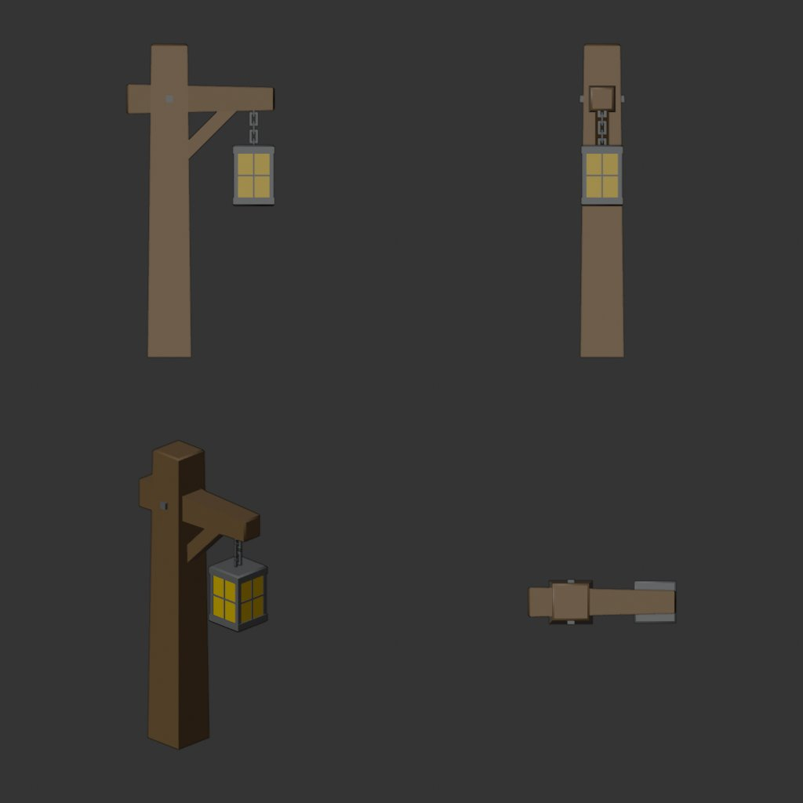
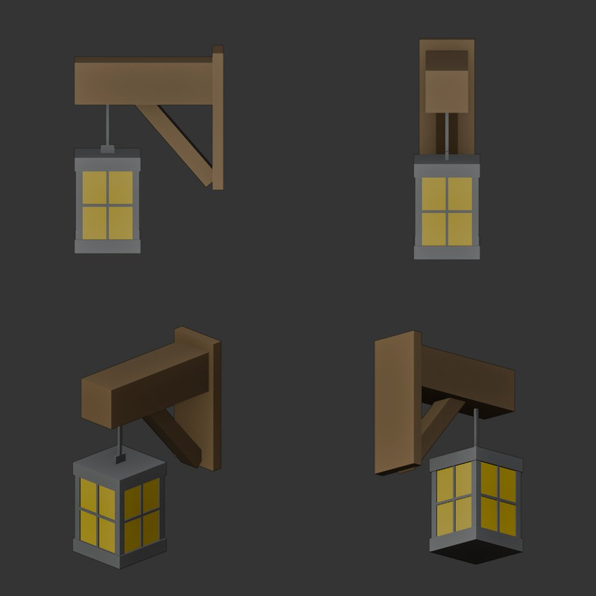
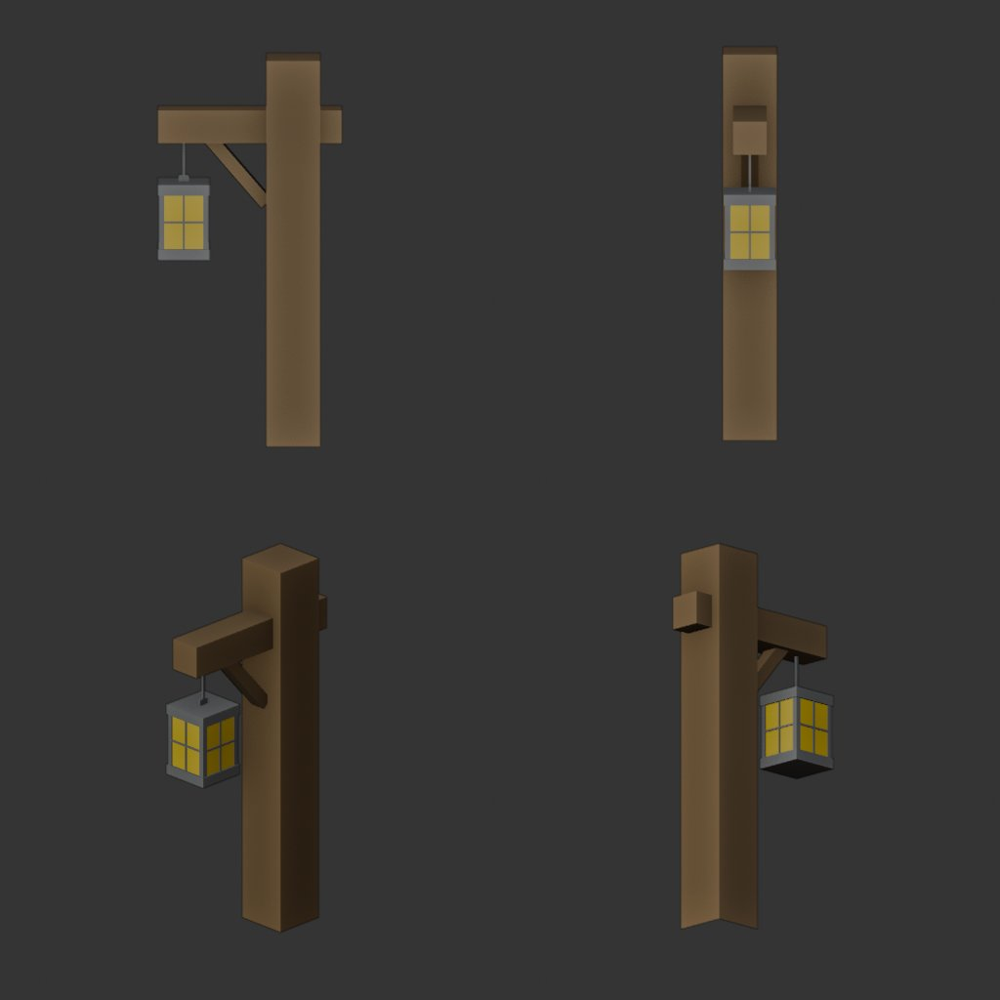

# Settlement lantern — wall / standing split (Blender)

**Created:** 2026-10-28  
**Created by:** Claude Opus 5.5 (Blender 5.2 + Blender MCP)  
**Status:** assets prepared, **not wired** — runtime integration is a separate approved step  
**Related:** [Track B next optimization](./2026-10-28--settlement-track-b-next-optimization.md) (lantern 9 → 3 primitive candidate)

## Result

Two new GLBs derived from `public/models/settlement/lantern.glb` (Tomáš Bayer, CC0):

| File | Placement | Support |
| --- | --- | --- |
| `public/models/settlement/lantern_wall.glb` | house wall (`lampStyle === 'wall'`) | wall plate + short beam + knee brace, **no post** |
| `public/models/settlement/lantern_standing.glb` | freestanding (`lampStyle !== 'wall'`) | one post + through-beam + knee brace |

Author guidance for this pass: lanterns are small on screen, so simplification beats fidelity.

## Geometry statistics (measured from the GLB JSON)

| Metric | Original `lantern.glb` | Wall | Standing |
| --- | --- | --- | --- |
| Triangles | 624 | 144 | 144 |
| Render primitives | 9 | 3 | 3 |
| Materials | 3 | 3 | 3 |
| Mesh objects / nodes | 7 / 7 | 1 / 1 | 1 / 1 |
| Vertex attributes | POSITION, NORMAL, TEXCOORD_0 | POSITION, NORMAL | POSITION, NORMAL |
| File size | 45 904 B | 10 252 B | 10 232 B |

Primitive split in both files: Brown 34 tris, Grey 102 tris, Light 8 tris. No animations, cameras, lights, skins, extensions or unused materials. Reimported in Blender: 1 object, identity transform, 0 loose vertices; a backface-culled render from four sides shows no holes or flipped faces.

## Construction

The original is only axis-aligned boxes (obj2gltf, ~cm units). Both variants were **rebuilt from boxes at the original dimensions** rather than decimated, which was smaller and cleaner:

- **Lantern body (shared, both variants):** 24 × 35 × 24 cm. It keeps the grey base and top plates, four corner posts, a cross mullion and a transom band on every face. The glass is a single 4-sided light-coloured core whose caps are hidden by the plates.
- **Removed:** the per-pane frame geometry (≈350 tris in `Mesh3`), the 4-link chain (`Mesh4–7`, 124 tris) and the grey bolt on both post faces (`Mesh1`/`Mesh2`), plus hidden faces (the post bottom, the beam end inside the plate, caps under the plates).
- **Replaced:** the chain became one 1.2 cm hanger rod plus a top lug. The beam-to-post brace became one diagonal box.
- **Wall variant:** the vertical post is gone. A 4 × 20 × 50 cm wall plate carries a 50 cm beam (15.4 × 15.4 cm) and a diagonal knee brace. The lantern hangs at the same spot under the beam as in the original (38 cm from the support face, glass top 18.8 cm below the beam).
- **Standing variant:** 25 × 25 × 180 cm post. The beam runs through the post (stub on the back, as in the original), with a knee brace and the same lantern placement.

## Materials

Original three materials, same names and values (opaque, single-sided, metallic 0, roughness 1, no emissive, no textures):

| Material | Base colour | Role |
| --- | --- | --- |
| `ElwFor_Lantern_Brown` | (0.294, 0.200, 0.102) | wood: plate / post / beam / brace |
| `ElwFor_Lantern_Grey` | (0.239, 0.239, 0.239) | iron: frame, plates, rod |
| `ElwFor_Lantern_Light` | (1.000, 0.761, 0.039) | glass/flame panels |

No emissive was added. Night glow stays owned by the existing house PointLight (`createHouseLight`).

## Units, orientation and pivots

Both files are in **metres** (the original was unit-less ~cm). Y is up. The **arm points along glTF +Z**. In `attachLanternGlb`, pivot-local +Z is the wall's outward normal (`yaw = atan2(nx, nz)`), so the lantern hangs away from the wall. The original arm ran along +X, i.e. sideways along the wall.

| | Wall | Standing |
| --- | --- | --- |
| Size X × Y × Z (m) | 0.24 × 0.73 × 0.54 | 0.25 × 1.80 × 0.85 |
| Bounds Y | −0.48 … 0.25 | 0 … 1.80 |
| Bounds Z | 0 … 0.54 | −0.225 … 0.625 |
| Origin | back face of the wall plate, laterally centred, at plate mid-height | ground, centre of the post foot |
| Lantern bottom | Y −0.48 | Y 0.87 |

## Integration notes (not done; runtime unchanged)

Current call sites that would change:

- `src/settlement/propSpecs.ts:183` — `LANTERN_URL`. Add `LANTERN_WALL_URL` / `LANTERN_STANDING_URL`.
- `src/settlement/props.ts:1283–1285` — one `loadGltf(LANTERN_URL)` now feeds both `lanternFloor` and `lanternWall`. Load each from its own URL (the fallback to procedural lamps stays as is).
- `src/assets/assetIndex.ts:686–687` — the Asset Browser entries `settlement:lantern` / `settlement:lantern_wall` both use `LANTERN_URL`.
- `src/settlement/houseLighting.ts::attachLanternGlb` / `lampMountPose` — pivot/offset tuning (see below).

Required adjustments at integration:

1. **Wall scale changes meaningfully.** `preparePropFitMax` fits the longest axis. The original's longest axis was the 180-unit post, so at `LANTERN_WALL_MAX = 0.45` the lantern body was only ≈ 0.09 m tall (the documented "too small" WIP). The new wall variant's longest axis is its own 0.73 m height, so the same constant gives a ≈ 0.22 m body (×2.5). Retune `LANTERN_WALL_MAX` in-game instead of keeping 0.45.
2. **Wall depth offset.** `preparePropFitMax` re-centres X/Z on the bbox and sets min Y = 0, which discards the file origin. With the current `stickOut = 0.18 × visualSize`, the plate back would sit ≈ 0.085 m inside the wall (half depth 0.166 m − 0.081 m). Either shift the clone by +half-depth along local Z or use a fit that keeps the authored origin (plate back = wall surface).
3. **Standing size unchanged.** The longest axis is still the 1.8 m post, so `LANTERN_FLOOR_MAX = 0.28` gives the same visual size as today. FitMax centring puts the bbox centre, not the post, at the mount.
4. **PointLight position.** `attachHousePointLight` places the light at the mount point. With the wall variant the glass sits ≈ 0.2–0.3 m out from the wall, so the light could follow the glass centre. This is optional, and it is a `houseLighting.ts` change.
5. `src/world/caves/caveAdventureProps.test.ts` guards against `LANTERN_URL` loading in caves; extend that guard to the new URLs.

This split supersedes the "merge the 9 primitives at load time" helper proposed in Track B §1: the assets themselves are already 3 primitives each.

## Previews (Blender workbench, reimported GLBs, backface culling on)

| Original | Wall | Standing |
| --- | --- | --- |
|  |  |  |

New sheets show side (support construction), front (looking at the wall), three-quarter and low back views. The original sheet shows front, side, three-quarter and top views.

## Limitations

- Only Blender inspection was done. **No in-game / browser verification** has been performed.
- The pane frames are flatter than in the original (a single cross per face instead of a framed 2 × 2 grid with inset glass). This is acceptable at gameplay distance per the author note, but not pixel-identical.
- The new variants have no UVs (none are needed: no textures).

## Manual verification checklist (at integration)

- [ ] Wall lantern: plate flush with the wall on MegaKit and catalog houses, arm points outward, nothing intersects the wall.
- [ ] Wall lantern size reads correctly after retuning `LANTERN_WALL_MAX`.
- [ ] Standing lantern stands on the ground, post vertical, lantern facing away from the house.
- [ ] Day: colours match the old lantern. Night: the PointLight glow sits plausibly at the glass.
- [ ] Draw-call census: exterior lamps 9 → 3 submissions per lamp.
- [ ] Asset Browser `settlement:lantern*` entries render both variants.
